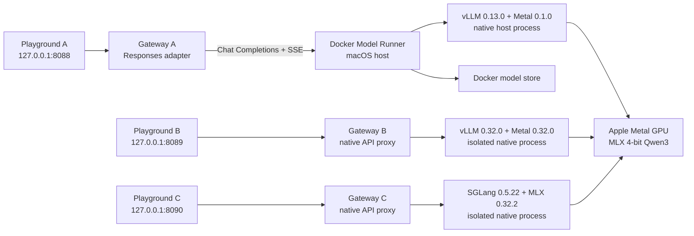

> **Current Responses API:** Compose now runs `RESPONSES_MODE=service`; see [Responses Core](RESPONSES-CORE.md) for supported fields, authentication and runtime requirements. Native runtime launchers select the checked-in Qwen template and tool parsers. Historical adapter/native feature descriptions below apply only to explicitly selected legacy modes.

# Local Qwen3: Docker Model Runner, native vLLM Metal, and SGLang

This project deploys three local services for comparing OpenAI-compatible APIs on the same small Qwen3 model. Service A uses Docker Model Runner (DMR), its bundled vLLM Metal runtime, and a text Responses adapter. Service B uses an isolated installation of vLLM Metal with its native OpenAI server. Service C uses SGLang's native MLX backend and native OpenAI handlers. All execute inference on the Mac's Metal GPU.

| Service | Playground / client base URL | Inference runtime | Responses implementation |
| --- | --- | --- | --- |
| A: Docker Model Runner | `http://127.0.0.1:8088` / `/v1` | Docker-managed vLLM 0.13.0 + Metal 0.1.0, with entrypoint repair | Local text adapter over Chat Completions |
| B: Native vLLM Metal | `http://127.0.0.1:8089` / `/v1` | Project-isolated vLLM 0.32.0 + Metal 0.32.0 | vLLM's native Responses API |
| C: SGLang MLX | `http://127.0.0.1:8090` / `/v1` | Project-isolated SGLang 0.5.22 + MLX | SGLang's native Responses API |

Service C was added after the A/B benchmark. Its complete setup, dependency pins, launch configuration, API examples, validation, and rollback are documented in [SGLANG.md](SGLANG.md). The recorded A/B benchmark results do not include SGLang.

To install Service C on this existing deployment:

```sh
bash scripts/install-sglang.sh
python3 scripts/sglang-service.py start
docker compose build playground
docker compose up -d
API_BASE_URL=http://127.0.0.1:8090 node scripts/smoke.mjs
```

Use the main panel's service selector to compare A, B, and C. Service C's gateway reaches the separate host engine at `http://host.docker.internal:18002/v1`; direct host diagnostics use `http://127.0.0.1:18002/v1`. The SGLang model shares the existing weight bundle, runs with a 32,768-token context, one active request, a 65,536-token KV pool, and thinking disabled by default. Its LaunchAgent is `local.responsible-api.sglang`; manage it with `python3 scripts/sglang-service.py start|stop|restart|status|uninstall`.

All three services are deployed and have passed real generation checks on this Mac. Current context and practical Responses features are described in [RESPONSES-FEATURES.md](RESPONSES-FEATURES.md). The earlier benchmark remains a historical 4,096-token configuration; its measurements have not been rewritten.

## Deployment record

The host inspected on **22 October 2026** has the following components:

| Component | Observed value |
| --- | --- |
| Hardware | Apple M3 Max, 128 GB unified memory |
| Docker Desktop | 4.62.0 |
| Docker Model Runner CLI | v1.0.12 |
| Model Runner library inside Docker Desktop | v1.0.18 |
| Bundled vLLM Metal artifact | `v0.1.0-20260126-121650` |
| Bundled vLLM core | 0.13.0 |
| Model | `mlx-community/Qwen3-0.6B-4bit` |
| Model format | MLX, 4-bit Safetensors |
| Download size | Approximately 351 MB, including model assets |
| DMR model digest | `sha256:4c871aaa1be2f0b14156553622c2fed6f62a4a0f1b9df3832cab5fac533cffcc` |
| Configured context | 32,768 tokens, including prompt and generated output |
| Playground and application API | `http://127.0.0.1:8088` |
| DMR host API | `http://127.0.0.1:12434` |
| Native comparison runtime | `.runtime/native-venv`, pinned to stable 0.32.0 |
| Native model server | `127.0.0.1:18001`, managed by a per-user LaunchAgent |
| SGLang runtime | `.runtime/sglang-venv`, SGLang 0.5.22 / MLX 0.32.2 |
| SGLang model server | `127.0.0.1:18002`, separate per-user LaunchAgent |

**All three services verified on 22 October 2026.** Each passed seven checks: Chat Completions JSON and SSE, Responses JSON and SSE, full-history multi-turn input, process health, and model catalog readiness. `docker model ps` identified `vllm-metal` as Service A's loaded backend. Service B served requests through its isolated vLLM 0.32.0 server. Service C's logs confirmed `MlxModelRunner` and successful MLX model loading.

| Service | Verification time, China Standard Time | Result | Evidence |
| --- | --- | --- | --- |
| A: Docker Model Runner | 12:53:38 | 7/7 checks passed | [service-status.json](service-status.json) |
| B: Native vLLM Metal | 12:57:30 | 7/7 checks passed | [service-status-native.json](service-status-native.json) |
| C: SGLang MLX | 21:45 | 7/7 checks passed | [service-status-sglang.json](service-status-sglang.json) |

The OpenAI Python SDK **3.36.1** also passed real Chat Completions, Responses JSON, and accumulated Responses streaming requests against all three services. Service C's [SDK record](sglang-sdk-check.json) is saved separately. Automated gateway integration tests cover the three-service routing and fixed documentation routes.

These simple prompts are API smoke checks, not model-quality evaluations. Both services returned “The capital of France is Paris.” The small model's multi-turn output was fluent but imperfect, which is consistent with using this deployment for integration tests rather than assessing reasoning quality.

Services A and B use this canonical model ID:

```text
huggingface.co/mlx-community/qwen3-0.6b-4bit:latest
```

Service C uses `mlx-community/Qwen3-0.6B-4bit` because SGLang reserves colons for LoRA adapter names. All three aliases address the same on-disk model weights. The playground selects the correct ID for each service.

## Architecture



Docker containers on macOS do not provide Metal GPU passthrough. DMR's native host process is intentional: it lets the model use the Apple GPU while Docker retains the model lifecycle. Putting a Linux CUDA vLLM image in Compose would not provide this Metal execution path.

Service A's container connects to `http://model-runner.docker.internal/engines/vllm-metal/v1`. A process running directly on the Mac connects to `http://127.0.0.1:12434/engines/vllm-metal/v1`. Service B's container connects through Docker Desktop's `http://host.docker.internal:18001/v1` to the native server listening on host loopback. That connection was checked on this Docker Desktop installation. Container `localhost` refers to the container itself.

## Update audit

Checked against official release information on **22 October 2026**:

| Software | Existing installation | Latest stable checked | Deployment action |
| --- | --- | --- | --- |
| Docker Desktop | 4.62.0 | 4.96.2, released 22 October 2026 | Running Desktop remains unchanged; see the Docker update guide |
| Docker Model Runner | CLI 1.0.12; Desktop-linked library 1.0.18 | 1.2.9, released 22 October 2026 | Retain Docker-managed versions for Service A; newer Metal artifact staged separately |
| vLLM Metal | 0.1.0, January 2026 artifact | 0.32.0, released 21 October 2026 | Install separately for Service B |
| vLLM core | 0.13.0 in Docker bundle | 0.32.0 is the compatible core for Metal 0.32.0 | Install matching native macOS wheel for Service B |

These are release availability checks. They do not mean Docker Desktop was upgraded. Metal 0.32.0 requires native arm64 Python 3.12 and macOS 15 or newer. The inspected Mac runs macOS 26.6.2.

## Why this model

Qwen3-0.6B is a small text-generation member of the Qwen3 family and is sufficient for validating request formats, local inference, and the playground. The MLX community conversion uses four-bit weights to reduce download size and memory needs. The model's advertised weight size is about 335 MB; Docker's complete artifact includes configuration and tokenizer assets.

This is a development model. Short answers, translation, and simple instruction following are appropriate smoke tests. A successful API request does not establish reliable complex reasoning or tool use. The application disables Qwen thinking for quick text tests through the Chat Completions template option `enable_thinking: false`.

## Prerequisites

- An Apple Silicon Mac with Docker Desktop running and Docker Model Runner enabled.
- The `docker model` CLI available in the shell.
- Internet access for the first model and container image downloads.
- Node.js 22 or later if running the gateway directly or running its local test suite.
- Ports 12434 and 8088 available on the Mac.

The tested host already contained the vLLM Metal bundle. Docker's current documentation and latest vLLM Metal documentation describe newer releases; use the version-specific compatibility notes in this guide for Docker Desktop 4.62.0.

## Install and start

From the project directory:

```sh
cd /Users/chuanmingliu/responsible-api
docker desktop enable model-runner --tcp 12434
docker model version
docker model status
docker model pull hf.co/mlx-community/Qwen3-0.6B-4bit
docker model list
```

**Validate the model digest before applying the repair.** The Hugging Face pull reference resolves a mutable `latest` tag. The shim and native service deliberately support only the exact bundle tested here. Run:

```sh
docker model inspect hf.co/mlx-community/Qwen3-0.6B-4bit | python3 -c '
import json, sys
expected = "sha256:4c871aaa1be2f0b14156553622c2fed6f62a4a0f1b9df3832cab5fac533cffcc"
actual = json.load(sys.stdin)["id"]
print("Downloaded model:", actual)
if actual != expected:
    sys.exit("STOP: model digest changed; revalidate the bundle before repairing or starting either service.")
'
```

If the digest differs, stop setup. Do not substitute the new digest into the scripts without checking its model format, tokenizer metadata, template, and behavior on both backends. A fresh deployment at a later date may need that revalidation even when the repository name has not changed.

For a normal, compatible DMR installation, install the Metal backend using the Docker command supported by that version. Docker's macOS introduction documents `docker model install-runner --backend vllm`. The installed CLI also advertises `--backend vllm-metal`, but this particular CLI prints **“Standalone installation not supported with Docker Desktop”** and exits without updating the backend. Treat the resulting status and generation checks as authoritative.

This deployment requires the compatibility repair described below before setting a context size on the bundled January 2026 runtime. To reproduce both services after enabling DMR:

```sh
./scripts/setup.sh
./scripts/status.sh
python3 scripts/native-service.py status
```

The setup script pulls the model, verifies the expected digest, applies the version-gated repair, configures and preloads Service A, installs Service B in its isolated environment, registers its LaunchAgent, builds the gateway image, and starts the Compose gateways. Service C's engine requires its separate installer above. The first native startup took approximately 2½ minutes on this Mac, including initial library loading. Initialization can continue after setup returns; generation checks are the final readiness gate.

The equivalent core commands for Service A after applying the repair are:

```sh
docker model unload huggingface.co/mlx-community/qwen3-0.6b-4bit:latest
docker model configure --context-size 32768 --keep-alive 1h \
  huggingface.co/mlx-community/qwen3-0.6b-4bit:latest
docker model run --detach \
  huggingface.co/mlx-community/qwen3-0.6b-4bit:latest
docker compose up -d --build
```

Open **http://127.0.0.1:8088** for Service A or **http://127.0.0.1:8089** for Service B. Service A's panel also provides the comparison workflow. The deployment document is available at **http://127.0.0.1:8088/docs** and **http://127.0.0.1:8089/docs**.

The project includes scripts for setup, diagnosis, and compatibility repair. The manual repair command for this exact bundled runtime is:

```sh
python3 scripts/repair-dmr-entrypoint.py
```

It changes files in Docker's per-user model environment, so run it with permission to write there. The script refuses unrecognized runtime versions and preserves the original entrypoint. Its model-specific scope is explained below.

### Install Service B's isolated runtime

```sh
./scripts/install-native.sh
```

This script creates `.runtime/native-venv`, uses an existing native Python 3.12 interpreter, and installs these exact official release assets:

```text
https://github.com/vllm-project/vllm/releases/download/v0.32.0/vllm-0.32.0%2Bcpu-cp38-abi3-macosx_11_0_arm64.whl
https://github.com/vllm-project/vllm-metal/releases/download/v0.32.0/vllm_metal-0.32.0-cp312-cp312-macosx_15_0_arm64.whl
```

The `+cpu` string is the upstream macOS vLLM core wheel's package version; the Metal platform plugin supplies GPU inference. It does not imply this service is configured for CPU inference.

Dependency downloads stay under `.runtime/uv-cache`; installation output is saved to `.runtime/native-install.log`. The script checks installed versions before repeating a package installation and writes the resolved environment to `.runtime/native-install.json`. The observed native packages were vLLM `0.32.0+cpu`, vLLM Metal `0.32.0`, MLX `0.32.2`, mlx-lm `0.32.0`, and Transformers `5.19.0`, using Python `3.12.4`. It leaves Docker's Python environment and globally installed packages unchanged.

The saved [native runtime manifest](native-runtime.json) records the interpreter and wheel sources; [native-requirements.txt](native-requirements.txt) records the complete installed Python package inventory. The primary wheel versions are pinned in the installer. Its dependency resolution can change on a fresh installation unless the saved inventory is also applied as constraints.

The model weights are small, but the serving dependencies have their own disk cost: the installed native environment measured about 1.7 GB, with about 1.8 GB in the project uv download cache on this host. These are separate from Docker's existing runtime and model storage.

Start the native model service and inspect its process:

```sh
python3 scripts/native-service.py start
python3 scripts/native-service.py status
```

The script registers `~/Library/LaunchAgents/local.responsible-api.native.plist`. It launches the isolated `vllm serve` executable with the same corrected Docker model bundle, host `127.0.0.1`, port 18001, the canonical model alias, a 32,768-token context, one concurrent sequence, and `--gpu-memory-utilization 0.10`. Default chat-template settings disable thinking. Its model access is offline (`HF_HUB_OFFLINE=1`), and Hugging Face and vLLM runtime caches stay under this project's `.runtime` directory.

The model download must include its tokenizer chat template; a Safetensors file alone is insufficient for chat serving. Service B reuses the downloaded weights, so removing the Qwen model from DMR also breaks Service B's model path.

### Native gateway alternative for Service A

The model should continue running through DMR. To run only the Node gateway on the host, stop the Compose service first to free port 8088, then:

```sh
docker compose stop playground
cp .env.example .env
npm start
```

The native gateway's upstream must point at the host URL, `http://127.0.0.1:12434/engines/vllm-metal/v1`. The application has no npm runtime dependencies.

## Docker Desktop 4.62.0 compatibility repair

This machine exposed a mismatch inside the packaged backend:

1. DMR invokes `python3 -m vllm_metal.server` for Metal models.
2. When a context size is configured, DMR appends `--max-model-len`.
3. The bundled `vllm_metal.server` is an older, small FastAPI server that does not accept that argument. It accepts `stream` in the request model but does not implement a streaming response. It also formats messages itself and approximates usage by counting words.
4. The same Python bundle contains vLLM core 0.13.0, its OpenAI server, and the registered Metal platform plugin.

The repair is a small, reversible entrypoint shim: keep DMR's existing lifecycle and model store, but delegate the legacy server entrypoint to the bundled vLLM OpenAI server. It applies only to the recorded Qwen3 model digest; other models continue using Docker's original entrypoint. The original file is backed up as `server.py.responsible-api-original`. This is a local compatibility workaround, not a claim that Docker shipped the repaired entrypoint.

The shim preserves the `--model`, `--host`, and `--port` values supplied by DMR and gives vLLM the canonical served model name. DMR forwards request bodies unchanged; a model alias mismatch otherwise produces a model-not-found error. The final setup uses one concurrent sequence and a 32,768-token context to keep resource usage predictable.

A second packaging issue affects tokenizer metadata: DMR materialized JSON tokenizer configuration as `template.jinja` in this model bundle. The repair validates and copies that JSON to `tokenizer_config.json`, retaining the existing chat template and special tokens. It does not alter the weights. The repair records a hash so restoration only removes metadata created by the script, and refuses to overwrite later changes.

To restore the original runtime, first stop requests, stop both native services that share its tokenizer metadata, and unload the DMR test model:

```sh
python3 scripts/native-service.py stop
python3 scripts/sglang-service.py stop
docker model unload huggingface.co/mlx-community/qwen3-0.6b-4bit:latest
python3 scripts/repair-dmr-entrypoint.py --restore
```

Restoration restores the old server's limitations and removes only the tokenizer metadata created by the repair. Reapply the validated repair before restarting these services. The model digest and runtime version are deliberate guards: if a future pull or update changes either, investigate the new packaging instead of bypassing those checks.

The backend is pinned in Docker Desktop's DMR v1.0.18 source to `v0.1.0-20260126-121650`. Reinstalling that backend downloads the same artifact from:

```text
registry-1.docker.io/docker/model-runner:vllm-metal-v0.1.0-20260126-121650
```

Its extracted native environment is at:

```text
~/.docker/model-runner/vllm-metal/
```

The pinned source has no environment variable for selecting a different Metal artifact version. A future Docker Desktop update or backend reinstall can replace the shim. After either event, rerun the status and inference checks before deciding whether the repair is still needed. Do not apply the old repair blindly to a newer package. See [DOCKER-METAL-UPDATE.md](DOCKER-METAL-UPDATE.md) for the latest official `darwin/arm64` artifact, verified download evidence, and why downloading it alone does not update this Desktop's active engine.

## API endpoints

Use the playground gateways as the application-facing endpoints. Service A uses port 8088; Service B uses port 8089. Both gateways expose the model catalog, Chat Completions, and Responses creation routes below. Service B forwards requests to vLLM's native handlers; the gateway does not add retrieval, deletion, or arbitrary vLLM administration routes.

| Method | URL | Purpose |
| --- | --- | --- |
| GET | `/healthz` | Gateway process liveness |
| GET | `/readyz` | Catalog readiness; returns 503 if the selected model is unavailable |
| GET | `/api/status` | Reachability and selected model presence in DMR's catalog |
| GET | `/api/config` | Model, backend, context, and API configuration |
| GET | `/v1/models` | Forwarded model catalog |
| POST | `/v1/chat/completions` | Forwarded Chat Completions request |
| POST | `/v1/responses` | Local text Responses compatibility adapter |
| GET | `/docs` | This deployment guide |

The local API requires no key. An OpenAI SDK that requires a key argument can use a placeholder such as `local`. Use **`http://127.0.0.1:8088/v1`** for Service A or **`http://127.0.0.1:8089/v1`** for Service B.

### Responses example

```sh
curl --fail-with-body http://127.0.0.1:8088/v1/responses \
  -H 'Content-Type: application/json' \
  -d '{
    "model": "huggingface.co/mlx-community/qwen3-0.6b-4bit:latest",
    "input": "Reply with one short sentence about running locally.",
    "store": false,
    "max_output_tokens": 128,
    "temperature": 0.3
  }'
```

For streaming, add `"stream": true` and use `curl -N`. The stream emits Responses events, including `response.output_text.delta` and a terminal `response.completed`, `response.incomplete`, or `response.failed` event. Generated text originates in the live vLLM Chat Completions stream; the adapter translates its envelopes.

### Chat Completions example

```sh
curl --fail-with-body http://127.0.0.1:8088/v1/chat/completions \
  -H 'Content-Type: application/json' \
  -d '{
    "model": "huggingface.co/mlx-community/qwen3-0.6b-4bit:latest",
    "messages": [{"role": "user", "content": "What is 2 + 2?"}],
    "max_tokens": 64,
    "temperature": 0,
    "chat_template_kwargs": {"enable_thinking": false}
  }'
```

For direct DMR diagnostics, replace the gateway URL with `http://127.0.0.1:12434/engines/vllm-metal/v1/chat/completions`.

### Python SDK example

In an environment where the OpenAI Python SDK is installed:

```python
from openai import OpenAI

client = OpenAI(base_url="http://127.0.0.1:8088/v1", api_key="local")
response = client.responses.create(
    model="huggingface.co/mlx-community/qwen3-0.6b-4bit:latest",
    input="Say hello in English and Chinese.",
    store=False,
    max_output_tokens=128,
)
print(response.output_text)
```

### Service A: Responses compatibility scope

This installation's DMR proxy returned 404 for native Responses routes during direct probing. The project therefore provides an explicitly limited adapter over DMR Chat Completions. The presence of Responses code in an upstream source tag does not establish that Docker Desktop exposes those routes.

| Capability | Gateway adapter behavior |
| --- | --- |
| Text input string | Supported |
| Text message array | Supported; send full conversation history |
| System instructions | Supported through `instructions` |
| Streaming | Translates live Chat Completions SSE events |
| `max_output_tokens`, `temperature`, `top_p` | Forwarded as generation settings |
| Token usage | Mapped from upstream reported token counts |
| Output token limit | Produces `status: "incomplete"` when upstream finishes with `length` |
| Persistence | Stateless; omit `store` or set `store: false` |
| `previous_response_id` | Rejected; send full history instead |
| Tools, images, audio, and files | Unsupported by this adapter |
| JSON schema / structured output | Unsupported by this adapter |
| Background execution | Unsupported |
| Response retrieval or deletion | Unsupported |

Unsupported parameters are rejected instead of silently claiming full OpenAI compatibility. Direct Chat Completions can expose additional backend parameters, but this guide makes no promise about untested capabilities of the small Qwen model.

### Comparing A and B

Send the same model ID, prompt, temperature, and maximum output length to each base URL. Compare their text, usage counts, first-token latency, total duration, and streaming completion. Keep the context limit and concurrency equal to make the experiment easier to interpret. Run requests sequentially when comparing single-request latency because both runtimes share the Mac's GPU and unified memory.

Service A always translates Responses into Chat Completions. Service B uses vLLM's native Responses protocol. This distinction is separate from the vLLM version difference, so a latency difference cannot be attributed solely to the adapter. Neither service uses an OpenAI cloud model.

Use `store: false` and full input history for comparable stateless tests. A successful native Responses request in Service B does not by itself verify every OpenAI feature, hosted tool, persistence option, or structured-output mode.

For native backend diagnostics, the host-only base URL is `http://127.0.0.1:18001/v1`. The public comparison URLs remain ports 8088 and 8089; neither gateway promises complete parity with every OpenAI endpoint.

### Repeated benchmarks

The [full benchmark report](benchmarks/2026-10-22-qwen3-comparison/REPORT.md) and [offline visual report](benchmarks/2026-10-22-qwen3-comparison/report.html) compare nine workloads through ports 8088 and 8089. Raw requests, streamed events, token usage, timings, errors, environment snapshots, JSON summaries, and CSV results are retained alongside the report.

```sh
node scripts/benchmark.mjs
```

The defaults run 10 measured samples and two warmups per serial workload, plus five measured four-client batches and one warmup batch per concurrent workload: 220 measured requests and 44 warmups total. The suite includes natural short Chat Completions and Responses, fixed 128- and 512-token Chat Completions, approximately 2,000-token prompts with unique and repeated prefixes, longer Responses, and four-client bursts on both APIs. Fixed-output tests use `ignore_eos`; they measure synthetic generation performance, not answer quality.

Each round alternates which service runs first, using identical paired prompts. Services never generate concurrently with each other. Warmups remain in the raw evidence but are excluded from summaries. Both engines allow one active sequence, so the four-client tests include queueing. The primary throughput metric uses server-reported output tokens divided by complete client wall time; concurrent goodput divides all successful output tokens by the complete batch duration. First-token timing begins at the first nonempty text delta. With 10 serial samples, nearest-rank p95 is the observed maximum, not a reliable estimate of rare production tails.

Results are written to a new timestamped `docs/benchmarks/` directory. Optional overrides include `BENCH_OUT_DIR`, `BENCH_CASES` (comma-separated scenario IDs from the script), `BENCH_REPEATS`, `BENCH_WARMUPS`, `BENCH_BATCH_REPEATS`, `BENCH_BATCH_WARMUPS`, and `BENCH_TIMEOUT_MS`. For example:

```sh
BENCH_CASES=chat_decode_128,chat_decode_512 BENCH_REPEATS=20 node scripts/benchmark.mjs
node --test tests/benchmark.test.mjs
```

Generate the visual and Markdown reports from a completed result directory with the separate reporting environment:

```sh
# Only needed when recreating the reporting environment.
uv venv --python 3.12 .runtime/benchmark-tools
uv pip install --python .runtime/benchmark-tools/bin/python matplotlib==3.11.2 numpy==2.5.4

MPLCONFIGDIR="$PWD/.runtime/matplotlib" .runtime/benchmark-tools/bin/python \
  scripts/benchmark-report.py docs/benchmarks/2026-10-22-qwen3-comparison
```

These measurements compare the deployed configurations, including their different runtime versions, gateways, Responses implementations, and cache behavior. They do not isolate Docker overhead, cold-start cost, peak memory, or answer quality. Both engines use native Metal execution on this Mac and the same quantized weights.

### Earlier smoke timing

To repeat the smaller scripted timing check:

```sh
node scripts/compare.mjs
```

It runs the same Chat Completions prompt sequentially against both services, performs one warm-up per service, records three measured samples per service, and saves `docs/comparison.json`. It records first-token time, total request duration, output tokens, and throughput computed from full request wall time. This compares the two deployed configurations; it does not isolate engine performance from runtime version, prefix-cache behavior, or gateway overhead.

Observed on this Mac at **12:58:30 China Standard Time, 22 October 2026**, using the rain-cloud explanation prompt saved in [comparison.json](comparison.json):

| Service | Mean total duration | Mean first-token time | Mean output throughput | Output tokens per sample |
| --- | --- | --- | --- | --- |
| A: Docker Model Runner | 369.3 ms | 30.7 ms | 273.5 tokens/s | 101 |
| B: Native vLLM Metal | 403.3 ms | 44.0 ms | 233.0 tokens/s | 94 |

The runtimes produced different text and output lengths despite identical input settings. These three warm samples establish that both services run quickly for this test; they do not establish a general speed or quality winner. Throughput includes the complete request duration, rather than measuring only token decoding.

## Status and verification

```sh
docker model status
docker model ps
docker model configure show
docker compose ps
curl --fail-with-body http://127.0.0.1:8088/healthz
curl --fail-with-body http://127.0.0.1:8088/api/status
node scripts/smoke.mjs
API_BASE_URL=http://127.0.0.1:8089 node scripts/smoke.mjs
```

The smoke script writes a separate evidence file for each service identity. For C, run `API_BASE_URL=http://127.0.0.1:8090 node scripts/smoke.mjs`. The Docker image contains a copy of the documentation at build time; rebuild with `docker compose build playground && docker compose up -d` after changing documentation or refreshing the saved evidence if the browser should show the updated copy.

Interpret these signals separately:

- A healthy gateway container means its HTTP process responds.
- A reachable model catalog means DMR can list the model. DMR lists shared models even under engine-specific URLs; this is not proof of GPU inference.
- `docker model ps` identifies which backend has loaded a model.
- A real generation request verifies that the selected model executes.
- A streaming request must return incremental SSE events and a terminal event, rather than a JSON result buffered until completion.

The first request can take longer because DMR loads model weights and initializes the Metal runtime. Service A uses a one-hour keep-alive: after an idle unload, a new request loads it again. Service B stays running under its LaunchAgent until stopped.

## Lifecycle and logs

```sh
# Gateway logs
docker compose logs --tail 100 playground

# Model runner logs
docker model logs

# Native comparison runtime logs
tail -n 100 .runtime/native-engine.log
tail -n 100 .runtime/native-engine.err.log

# Restart only the gateway
docker compose restart playground

# Restart Service B's gateway
docker compose restart native-playground

# Restart Service B's native inference process
python3 scripts/native-service.py restart

# Stop the gateway while preserving its image and the downloaded model
docker compose down

# Release the model's runtime memory
docker model unload huggingface.co/mlx-community/qwen3-0.6b-4bit:latest

# Stop Service B's native process for the current login session
python3 scripts/native-service.py stop

# Start the gateway again
docker compose up -d
python3 scripts/native-service.py start
```

All three Compose services have `restart: unless-stopped`. They resume with Docker after an ordinary restart unless explicitly stopped. Services B and C run as separate per-user LaunchAgents; see [SGLANG.md](SGLANG.md) for C's lifecycle and logs. DMR loads models on demand; keep-alive controls idle unloading and does not itself launch Docker Desktop at login. Start Docker Desktop normally after a Mac restart, then run the status and smoke checks.

Service B's LaunchAgent has `RunAtLoad` and `KeepAlive` enabled, so it starts at user login and restarts after an unexpected exit. `stop` unloads it for the current login session; `uninstall` also removes its plist to prevent future automatic starts:

```sh
python3 scripts/native-service.py uninstall
```

The `.runtime/native-venv` environment and downloaded model are retained by these lifecycle commands. Keep the project directory at its current path unless you recreate the LaunchAgent, because its executable, working directory, and log paths are absolute.

The gateway is published only on `127.0.0.1`. Its container runs as a non-root user with a read-only filesystem, a small temporary filesystem, dropped Linux capabilities, and a memory limit. DMR's API is unauthenticated, so this setup is intended for local testing; no public network exposure is configured by the project.

## Troubleshooting

| Symptom | Check or remedy |
| --- | --- |
| `docker: 'model' is not a docker command` | Verify Docker Desktop's CLI integration and the `~/.docker/cli-plugins/docker-model` link. |
| Host port 12434 refuses connections | Start Docker Desktop and enable host TCP using `docker desktop enable model-runner --tcp 12434`. |
| Gateway is healthy but model catalog is unreachable | Check `docker model status`; confirm the container uses `model-runner.docker.internal`, not `127.0.0.1`. |
| `unrecognized arguments: --max-model-len` | The legacy packaged server is still active. Validate/apply the documented entrypoint repair, then unload and reload this model. |
| Streaming gives one JSON body or no deltas | Verify the server is vLLM core, not the legacy `vllm_metal.server` implementation. |
| Model-not-found from vLLM | Match `--served-model-name` to the full canonical model ID and verify the model appears in `docker model list`. |
| `/engines/v1/responses` returns 404 | Use the project's `http://127.0.0.1:8088/v1/responses` adapter. |
| 400 for `previous_response_id`, tools, or schema | These capabilities are outside the adapter's stated scope. Send text history explicitly. |
| Answer ends early | Increase `max_output_tokens` while keeping total input and output within the configured 32,768-token context. |
| A model stays in memory after closing the page | Service A keeps it for up to one idle hour; unload it explicitly to release it. Stop the native LaunchAgent separately for Service B. |
| Native gateway returns an upstream error | Check `python3 scripts/native-service.py status` and `.runtime/native-engine.err.log`; confirm port 18001 responds before retrying. |
| Repair disappears after updating Docker | The managed environment may have been replaced. Recheck the new backend before reapplying a version-specific repair. |

## Sources and version boundaries

- [Docker: vLLM Metal on macOS](https://www.docker.com/blog/docker-model-runner-vllm-metal-macos/) explains native host execution, MLX models, and Docker Desktop 4.62 support.
- [Docker Model Runner API reference](https://docs.docker.com/ai/model-runner/api-reference/) documents host/container URLs and Chat Completions routes.
- [Docker model pull reference](https://docs.docker.com/reference/cli/docker/model/pull/) documents the Hugging Face reference form.
- [MLX Qwen3-0.6B-4bit model card](https://huggingface.co/mlx-community/Qwen3-0.6B-4bit) identifies the model conversion, quantization, and Apache 2.0 license.
- [vLLM Metal documentation](https://docs.vllm.ai/projects/vllm-metal/en/latest/) describes the current project; its latest features may exceed this host's bundled version.
- [Pinned DMR v1.0.18 Metal backend](https://github.com/docker/model-runner/blob/v1.0.18/pkg/inference/backends/vllmmetal/vllmmetal.go) establishes the artifact version, native install directory, and entrypoint arguments.
- [Pinned DMR runner proxy](https://github.com/docker/model-runner/blob/v1.0.18/pkg/inference/scheduling/runner.go) establishes loopback backend ports, health probing, and request forwarding.
- [DMR v1.0.12 Responses handler](https://github.com/docker/model-runner/blob/v1.0.12/pkg/responses/handler.go) is useful for source comparison; its availability in upstream source did not match the Desktop routes observed here.
- [Docker Desktop release notes](https://docs.docker.com/desktop/release-notes/#4961) identify the latest Desktop version checked.
- [Docker Model Runner v1.2.9 release](https://github.com/docker/model-runner/releases/tag/v1.2.9) identifies the latest standalone project release checked.
- [vLLM Metal v0.32.0 release](https://github.com/vllm-project/vllm-metal/releases/tag/v0.32.0) documents the native stable installation requirements and matching core version.

This document records the actual deployment choices and observed compatibility issues. Revalidate versions, routes, and generation after upgrading Docker, vLLM, or the model.
