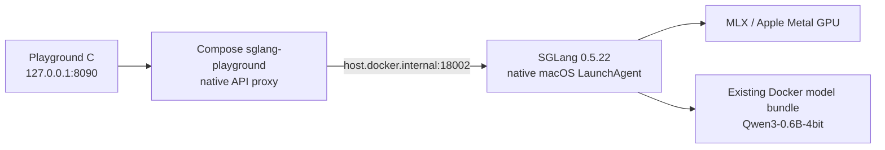

> **Current public API:** The default SGLang gateway now uses the [service-owned Responses Core](RESPONSES-CORE.md). Stored/background Responses described below are available only in legacy native pass-through mode; they are not part of the new Core contract.

# SGLang MLX service on this Mac

Service C adds an isolated SGLang inference engine to the existing Qwen3 playground. SGLang runs natively on macOS with its MLX backend and the Apple Metal GPU. Its gateway and playground run in Docker Compose. The model weights are shared with Services A and B.

| Component | Address or value |
| --- | --- |
| Playground C | [http://127.0.0.1:8090](http://127.0.0.1:8090) |
| Application API base | `http://127.0.0.1:8090/v1` |
| Native engine API base | `http://127.0.0.1:18002/v1` |
| Deployment guide in the panel | [http://127.0.0.1:8090/docs/sglang](http://127.0.0.1:8090/docs/sglang) |
| Gateway service | `sglang-playground` |
| macOS LaunchAgent | `local.responsible-api.sglang` |
| Runtime | SGLang `0.5.22`, upstream MLX backend |
| Source tag / commit | `v0.5.22` / `baa9befa381511cd4d56f83980951e5a45fffc6d` |
| Model | `mlx-community/Qwen3-0.6B-4bit` |
| Client model ID | `mlx-community/Qwen3-0.6B-4bit` |
| Responses implementation | SGLang's native `/v1/responses` handler |

## Full context and practical Responses

All three engines now use the full **32,768-token context** documented by [Qwen](https://huggingface.co/Qwen/Qwen3-0.6B). The model config has a 40,960-position ceiling; that is not treated as a documented context-quality guarantee. Prefix caching is automatic in SGLang and native vLLM Metal; the older Docker-managed Metal engine does not reuse KV prefixes. The panel displays cached-token counts, response IDs, and optional stored-conversation/background controls.

See [RESPONSES-FEATURES.md](RESPONSES-FEATURES.md), [context/cache verification](context-cache-verification.json), and [Responses feature verification](responses-feature-verification.json) for the updated configuration and measured checks.

## Original deployment verification record

**Real inference verified on 22 October 2026 at 21:45:03 China Standard Time.** Service C passed all seven live API checks through the gateway on port 8090: health, model readiness, Chat Completions JSON and SSE, Responses JSON and SSE, and stateless full-history multi-turn Responses. The [timestamped results](service-status-sglang.json) include generated text and token usage. The 21:44 startup confirmed the native `MlxModelRunner`, `--mlx-enable-sampling`, and the configured KV pool.

The official OpenAI Python SDK **3.36.1** separately passed Responses JSON, accumulated Responses streaming, and Chat Completions streaming; all three returned `ready`. The Responses streaming check asserted that concatenated text deltas matched `get_final_response().output_text`. See [SDK results](sglang-sdk-check.json).

These are API and transport smoke checks, not a model-quality evaluation. The simple capital-city prompt correctly returned “The capital of France is Paris.” The multi-turn answer was fluent but confused the user's identity with the assistant's, so its successful API result should not be interpreted as a successful reasoning test.

Installation completed at 21:36 China Standard Time, and `uv pip check` validated 151 packages.

The installed runtime is recorded in [`sglang-runtime.json`](sglang-runtime.json): Python 3.12.4 (`arm64`), SGLang 0.5.22, Torch 2.13.0, MLX / MLX-Metal 0.32.2, MLX-LM 0.32.2, Transformers 5.19.0, and OpenAI 2.6.1.

The main playground's Service C selector was also exercised with a real streamed Responses request and displayed the completed answer, token usage, and first-token timing. A subsequent `restart` completed successfully, retained MLX sampling, and returned `ready` from a new generation request. See the [restart and browser verification record](sglang-verification.json) and [playground screenshot](sglang-playground.png). The original automated suite passed 24 tests, including routing, streaming cancellation, and recovery from stale UI status.

## Architecture and scope



The macOS process performs inference. The container serves the UI and forwards OpenAI-compatible requests. It does not run SGLang or provide a Linux GPU passthrough path.

Service C uses the same quantized model directory as the two vLLM services:

```text
~/.docker/models/bundles/sha256/4c871aaa1be2f0b14156553622c2fed6f62a4a0f1b9df3832cab5fac533cffcc/model
```

Service C uses the client alias `mlx-community/Qwen3-0.6B-4bit`. Services A and B retain `huggingface.co/mlx-community/qwen3-0.6b-4bit:latest`. SGLang reserves a colon in served model names for LoRA addressing and rejects the Docker-style `:latest` alias during startup. The different API labels still address the exact same on-disk weights.

Compose uses the separate `SGLANG_MODEL` variable for Service C's gateway, while Services A and B use `MODEL`. If changing C's alias, update both `SGLANG_MODEL` and `--served-model-name` in the service manager, then restart the engine and recreate the gateway. Do not include a colon in the SGLang alias.

Docker Model Runner does not manage the SGLang process. Removing the shared model bundle would also break Services B and C.

## Requirements and installation choices

The pinned upstream documentation requires Apple Silicon, macOS 14 or newer, stable PyTorch 2.13.x, and MLX 0.32.0 or newer. It demonstrates Python 3.12. The project installer checks native `arm64` and Python 3.12, then creates a separate virtual environment using the Python executable from the existing native vLLM environment.

Prerequisites for the project installer:

- The existing project deployment, including `.runtime/native-venv/bin/python` and the prepared Qwen3 model bundle.
- `uv` and `git` available in the shell, plus network access during installation.
- Docker Desktop running for the gateway and playground.
- Host ports 8090 and 18002 available.

[`scripts/install-sglang.sh`](../scripts/install-sglang.sh) performs these steps:

1. Clones upstream tag `v0.5.22` into `.runtime/sglang-src` and checks the exact commit.
2. Creates `.runtime/sglang-venv`, separate from both vLLM installations.
3. Preserves the original source `python/pyproject.toml` as `pyproject.toml.original`, then copies upstream `pyproject_other.toml` over the active manifest. This is upstream's Apple backend installation path.
4. Installs the source checkout in editable mode with the `srt_mps` extra, explicitly pins `mlx==0.32.2` to match the existing native vLLM baseline, and sets `SGLANG_BUILD_RUST_EXTS=none`.
5. Runs `uv pip check` and records resolved versions in [`sglang-requirements.txt`](sglang-requirements.txt).

The `srt_mps` extra includes the text serving runtime. The broader `all_mps` extra also installs diffusion dependencies and is unnecessary for this deployment. Optional Rust extensions and separately compiled Metal kernels are omitted. The standard MLX execution path remains available without building those optional kernels or installing the full Xcode application.

Upstream's manifest pins Torch 2.13.0, TorchVision 0.28.0, TorchAudio 2.11.0, TorchCodec 0.15.0, Transformers 5.19.0, and OpenAI 2.6.1. The project additionally pins MLX 0.32.2. MLX-LM resolved to 0.32.2 for this installation; it and other unpinned dependencies can resolve to newer releases on a subsequent installation. The generated requirements file records the actual installed versions. The source commit and selected pins do not constitute a complete dependency lock; preserve the requirements record when reproducing measurements.

## Install and start

Run from the project directory:

```bash
cd /Users/chuanmingliu/responsible-api
bash scripts/install-sglang.sh
python3 scripts/sglang-service.py start
docker compose up -d --build
```

The Compose command rebuilds the shared gateway image and starts the configured playground services. The existing vLLM environments and shared model weights are not changed by the SGLang installer.

[`scripts/sglang-service.py`](../scripts/sglang-service.py) creates the per-user LaunchAgent at:

```text
~/Library/LaunchAgents/local.responsible-api.sglang.plist
```

It invokes the project-owned `scripts/sglang_server.py`, which wraps the upstream HTTP lifespan with retention and admission controls without modifying SGLang source. It starts at user login and restarts after process exit, with a 15-second throttle. It is a user service, not a system-wide boot daemon. The plist contains absolute project paths; if the project moves, run `uninstall` from the old location and `start` from the new location after preparing the environment there.

The engine is configured with:

| Setting | Value | Purpose |
| --- | --- | --- |
| Backend | `SGLANG_USE_MLX=1`, `--device mps` | Select the upstream Apple MLX path |
| Listen address | `127.0.0.1:18002` | Local engine endpoint |
| Context length | 32,768 tokens | Bound combined prompt and generated output |
| Maximum running requests | 1 | Keep initial comparison consistent with the vLLM deployments |
| Total token pool | 65,536 tokens | Bound the configured token capacity |
| Static memory fraction | 0.10 | Explicit token-pool sizing controls this MLX deployment |
| CUDA graphs | Disabled | Match the documented Metal launch path |
| Cache reporting | Enabled | Expose available token-cache accounting |
| MLX sampling | `--mlx-enable-sampling` | Apply temperature and top-p controls instead of always selecting greedy argmax |
| Default chat-template kwargs | `{"enable_thinking":false}` | Fast text-generation tests |
| Hugging Face downloads | `HF_HUB_OFFLINE=1` | Use the prepared local model assets |

The 65,536-token pool provides space for active tokens and reusable prefixes. The request limit is 32,768 combined input/output tokens. The memory-fraction setting is not a hard limit on all process memory, and requests above the running-request limit queue.

The current runtime log reports an attention KV pool of approximately **7,168.1 MiB**, using 65,537 slots including a padding slot, 28 layers, 8 KV heads, head dimension 128, and bfloat16 storage. This is the KV pool allocation, not the full process footprint. A separate approximately **107.5 GB** wired-memory limit reported by MLX is a configured limit, not an allocation or measured usage.

Upstream MLX sampling is disabled by default, which would make the playground's temperature and top-p controls ineffective. This deployment enables it; temperature-zero requests retain greedy behavior. The pinned MLX backend does not apply sampling penalties, including frequency and presence penalties. Do not infer their support from acceptance of a request field.

Runtime caches are project-local: `.runtime/hf-cache`, `.runtime/tiktoken-cache`, and `.runtime/sglang-cache`. The install cache is `.runtime/uv-cache`. The HF cache path is also used by the existing project setup; SGLang's virtual environment and engine logs are separate.

## API examples

The gateway uses `RESPONSES_MODE=native`, forwarding requests to SGLang instead of translating Responses requests into Chat Completions. Use the full model ID shown below.

Chat Completions:

```bash
curl --fail-with-body http://127.0.0.1:8090/v1/chat/completions \
  -H 'Content-Type: application/json' \
  -d '{
    "model":"mlx-community/Qwen3-0.6B-4bit",
    "messages":[{"role":"user","content":"Name the capital of France in one sentence."}],
    "temperature":0,
    "max_tokens":128,
    "chat_template_kwargs":{"enable_thinking":false}
  }'
```

Stateless Responses:

```bash
curl --fail-with-body http://127.0.0.1:8090/v1/responses \
  -H 'Content-Type: application/json' \
  -d '{
    "model":"mlx-community/Qwen3-0.6B-4bit",
    "input":"Name the capital of France in one sentence.",
    "temperature":0,
    "max_output_tokens":128,
    "store":false
  }'
```

For streaming, add `"stream":true` to either body and `-N` to `curl`. For stateless multi-turn Responses, send the full user/assistant message history in `input`. The current deployment enables native stored Responses, `previous_response_id`, retrieval, background jobs, and cancellation. The project launcher bounds retained state to one hour, 128 terminal records, and 64 MiB of serialized responses plus histories; active records and their parents are protected until completion. At most eight active Responses requests/background jobs are admitted. Stored state is process memory and disappears on engine restart. Capacity eviction can remove records sooner than one hour. See [the feature guide](RESPONSES-FEATURES.md) for lifecycle, cache-key, JSON-schema, and function-calling examples.

For an OpenAI SDK client, set `base_url="http://127.0.0.1:8090/v1"` and use a non-secret placeholder API key such as `local`. The gateway does not require authentication. Keep the default loopback binding for local use.

## Status, tests, and logs

These commands inspect the running deployment:

```bash
python3 scripts/sglang-service.py status
docker compose ps sglang-playground
curl --fail http://127.0.0.1:8090/healthz
curl --fail http://127.0.0.1:8090/readyz
curl --fail http://127.0.0.1:8090/api/status
curl --fail http://127.0.0.1:18002/v1/models
```

`/healthz` checks the gateway process. `/readyz` checks upstream model-catalog readiness. Neither replaces a real generation request. The LaunchAgent's `status` action reports macOS process state and can succeed while the engine is still loading.

Run the existing real-inference smoke suite against Service C:

```bash
API_BASE_URL=http://127.0.0.1:8090 node scripts/smoke.mjs
```

The seven checks cover gateway health, model readiness, Chat Completions JSON and SSE, Responses JSON and SSE, and stateless full-history multi-turn Responses. Successful completion writes [`service-status-sglang.json`](service-status-sglang.json). This file is a timestamped test record, not a live status feed.

Run the SDK checks using the existing client environment, which contains OpenAI Python 3.36.1:

```bash
API_BASE_URL=http://127.0.0.1:8090/v1 \
MODEL=mlx-community/Qwen3-0.6B-4bit \
.runtime/native-venv/bin/python tests/sdk-smoke.py
```

This client process sends HTTP requests to SGLang; it does not run vLLM inference. The SGLang server retains its separately pinned OpenAI 2.6.1 dependency. The command prints a JSON result; the deployment's saved output is [`sglang-sdk-check.json`](sglang-sdk-check.json).

Logs:

```bash
tail -n 100 .runtime/sglang-install.log
tail -n 100 .runtime/sglang-engine.log
tail -n 100 .runtime/sglang-engine.err.log
docker compose logs --tail=100 sglang-playground
```

The project does not configure log rotation. Review log sizes during extended use.

## Lifecycle and removal

```bash
# Start a stopped engine; an already loaded service is left running.
python3 scripts/sglang-service.py start

# Apply updated engine configuration and restart.
python3 scripts/sglang-service.py restart

# Stop this engine for the current login session.
python3 scripts/sglang-service.py stop

# Remove the login service and stop the gateway.
python3 scripts/sglang-service.py uninstall
docker compose stop sglang-playground
```

`stop` unloads the LaunchAgent but leaves its plist, so it can start again on a later login. `uninstall` unloads it and removes that plist. It retains the source checkout, virtual environment, caches, logs, requirements record, gateway image, and shared model bundle. This preserves the deployment evidence and avoids removing assets used by the other services. To restore the service afterward, run `start` and `docker compose up -d sglang-playground`.

## Comparison limits and troubleshooting

Service A uses Docker-managed vLLM 0.13.0 / Metal 0.1.0 with a Responses adapter. Service B uses native vLLM 0.32.0 / Metal 0.32.0. Service C uses native SGLang 0.5.22 / MLX with its own Responses handler. All three use the same model weights, but schedulers, cache behavior, token accounting, templates, and serving implementations can differ.

The earlier two-service benchmark does not contain SGLang measurements. Run new measurements before drawing a three-service performance conclusion. For fair GPU comparisons, send measurement traffic to one backend at a time; the processes may remain resident. With the configured maximum of one running request, a concurrent-client workload primarily measures queueing behavior.

If startup reports unavailable MPS or Metal, check that the environment is native `arm64`, the exact Torch/MLX requirements are met, and the process has access to the GPU. Upstream validates both `torch.backends.mps.is_available()` and MLX Metal availability; a restrictive execution sandbox can interfere with these checks.

If model loading fails, confirm the shared bundle and repaired `tokenizer_config.json` still exist. The engine intentionally runs with Hugging Face offline mode, so it cannot repair missing assets by downloading them during startup.

If Chat Completions works but Responses fails, inspect the engine startup log. SGLang treats Responses-handler initialization as optional and can keep the server running after that handler fails. Check the actual `/v1/responses` endpoint rather than inferring support from model readiness.

Qwen3-0.6B-4bit is appropriate for API integration and performance experiments. API success does not establish model accuracy, dependable reasoning, tool-use quality, or compatibility with every OpenAI API feature. The deployed model and smoke suite are text-only.

## Official references

- [SGLang v0.5.22 release](https://github.com/sgl-project/sglang/releases/tag/v0.5.22)
- [Pinned Apple Silicon installation and quantization guide](https://github.com/sgl-project/sglang/blob/v0.5.22/docs/docs/hardware-platforms/apple_metal.mdx)
- [Apple dependency manifest](https://github.com/sgl-project/sglang/blob/v0.5.22/python/pyproject_other.toml)
- [Optional Rust build configuration](https://github.com/sgl-project/sglang/blob/v0.5.22/python/setup.py)
- [MLX runtime compatibility checks](https://github.com/sgl-project/sglang/blob/v0.5.22/python/sglang/srt/hardware_backend/mlx/runtime.py)
- [Serving options and default template kwargs](https://github.com/sgl-project/sglang/blob/v0.5.22/python/sglang/srt/arg_groups/fields/serving.py)
- [Served model name validation](https://github.com/sgl-project/sglang/blob/v0.5.22/python/sglang/srt/arg_groups/validation_hook.py)
- [MLX sampling controls and limitations](https://github.com/sgl-project/sglang/blob/v0.5.22/python/sglang/srt/arg_groups/fields/device.py)
- [Native Responses handler](https://github.com/sgl-project/sglang/blob/v0.5.22/python/sglang/srt/entrypoints/openai/serving_responses.py)
- [HTTP server and optional Responses initialization](https://github.com/sgl-project/sglang/blob/v0.5.22/python/sglang/srt/entrypoints/http_server.py)
