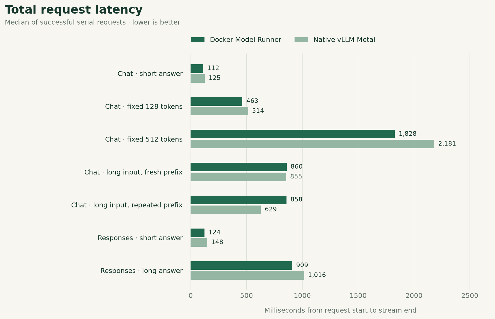
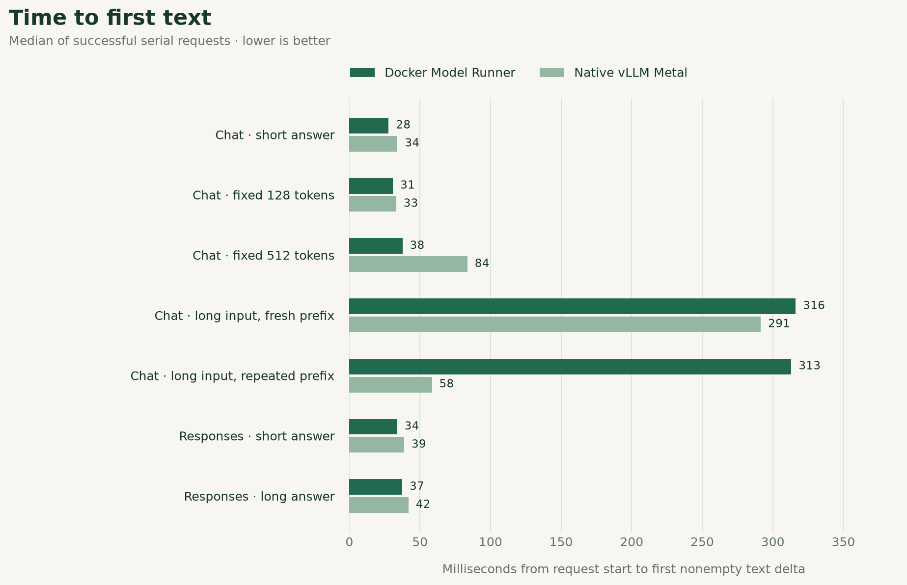
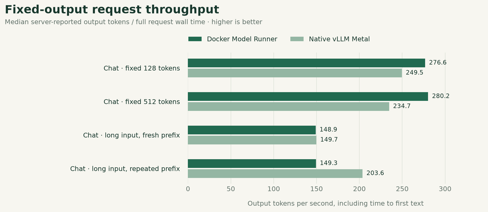
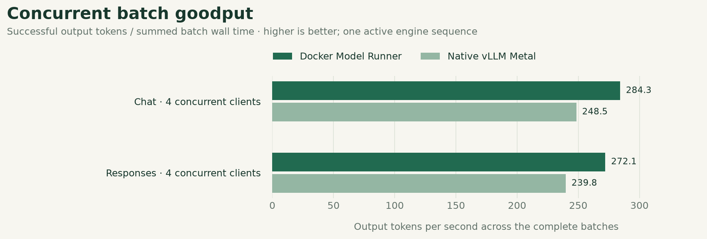

# Docker-managed vs native vLLM Metal benchmark

Same Qwen3-0.6B 4-bit weights, two deployed Metal services. Client-observed API performance on this Mac.

Run status: completed. Recorded 2026-10-22T05:26:44.705Z. Wall duration 3.2 minutes.

## Measured outcomes

- **Fixed 512-token Chat:** Native vLLM Metal took 1.19× as long. Median total: Docker 1,828 ms; native 2,181 ms.
- **Repeated long-input Chat:** Docker Model Runner took 1.36× as long. Median total: Docker 858 ms; native 629 ms. Repeated prompt; cache-hit counters are unavailable.
- **Validation:** 220/220 measured requests passed; 0 failed. Warmups are excluded.

These are observations from this run, not a controlled estimate of Docker overhead or a claim of statistical significance.

## Serial workloads

| Workload | Service | Passed / total | Errors | Median total | p95 total | Median TTFT | Output tokens | Wall tok/s |
| --- | --- | --- | --- | --- | --- | --- | --- | --- |
| Chat · short answer | Docker Model Runner | 10/10 | 0 | 112 ms | 138 ms | 28 ms | 23–35 | 224.8 |
| Chat · short answer | Native vLLM Metal | 10/10 | 0 | 125 ms | 203 ms | 34 ms | 23–37 | 204.2 |
| Chat · fixed 128 tokens | Docker Model Runner | 10/10 | 0 | 463 ms | 472 ms | 31 ms | 128 | 276.6 |
| Chat · fixed 128 tokens | Native vLLM Metal | 10/10 | 0 | 514 ms | 589 ms | 33 ms | 128 | 249.5 |
| Chat · fixed 512 tokens | Docker Model Runner | 10/10 | 0 | 1,828 ms | 1,944 ms | 38 ms | 512 | 280.2 |
| Chat · fixed 512 tokens | Native vLLM Metal | 10/10 | 0 | 2,181 ms | 2,227 ms | 84 ms | 512 | 234.7 |
| Chat · long input, fresh prefix | Docker Model Runner | 10/10 | 0 | 860 ms | 878 ms | 316 ms | 128 | 148.9 |
| Chat · long input, fresh prefix | Native vLLM Metal | 10/10 | 0 | 855 ms | 924 ms | 291 ms | 128 | 149.7 |
| Chat · long input, repeated prefix | Docker Model Runner | 10/10 | 0 | 858 ms | 901 ms | 313 ms | 128 | 149.3 |
| Chat · long input, repeated prefix | Native vLLM Metal | 10/10 | 0 | 629 ms | 890 ms | 58 ms | 128 | 203.6 |
| Responses · short answer | Docker Model Runner | 10/10 | 0 | 124 ms | 149 ms | 34 ms | 23–35 | 216.0 |
| Responses · short answer | Native vLLM Metal | 10/10 | 0 | 148 ms | 179 ms | 39 ms | 24–37 | 189.1 |
| Responses · long answer | Docker Model Runner | 10/10 | 0 | 909 ms | 924 ms | 37 ms | 256 | 281.7 |
| Responses · long answer | Native vLLM Metal | 10/10 | 0 | 1,016 ms | 1,087 ms | 42 ms | 256 | 252.0 |

Output tokens show the observed minimum–maximum. Wall tok/s and timing columns are medians except the explicitly labeled p95.

## Concurrent workloads

| Workload | Service | Passed / total | Good / all batches | Median request | p95 request | Median TTFT | Median batch | Batch tok/s | Output tokens |
| --- | --- | --- | --- | --- | --- | --- | --- | --- | --- |
| Chat · 4 concurrent clients | Docker Model Runner | 20/20 | 5/5 | 1,137 ms | 1,813 ms | 711 ms | 1,808 ms | 284.3 | 128 |
| Chat · 4 concurrent clients | Native vLLM Metal | 20/20 | 5/5 | 1,308 ms | 2,114 ms | 827 ms | 2,073 ms | 248.5 | 128 |
| Responses · 4 concurrent clients | Docker Model Runner | 20/20 | 5/5 | 1,120 ms | 1,828 ms | 668 ms | 1,812 ms | 272.1 | 103–128 |
| Responses · 4 concurrent clients | Native vLLM Metal | 20/20 | 5/5 | 1,326 ms | 2,308 ms | 843 ms | 2,036 ms | 239.8 | 128 |

Batch tok/s is aggregate goodput over all measured batch wall time. Each batch submits four client requests; one active engine sequence can cause queueing.

## Total request latency



Median of successful serial requests · lower is better. [SVG](latency.svg).

## Time to first text



Median of successful serial requests · lower is better. [SVG](ttft.svg).

## Fixed-output request throughput



Median server-reported output tokens / full request wall time · higher is better. [SVG](throughput.svg).

## Concurrent batch goodput



Successful output tokens / summed batch wall time · higher is better; one active engine sequence. [SVG](batch-goodput.svg).

## Context and cache evidence

| Workload | Service | Input tokens | Reported cached tokens | Median TTFT |
| --- | --- | --- | --- | --- |
| Chat · long input, fresh prefix | Docker Model Runner | 1,995 | — | 316 ms |
| Chat · long input, fresh prefix | Native vLLM Metal | 1,995 | — | 291 ms |
| Chat · long input, repeated prefix | Docker Model Runner | 1,991 | — | 313 ms |
| Chat · long input, repeated prefix | Native vLLM Metal | 1,991 | — | 58 ms |

A missing cached-token counter is shown as —; it is not evidence of zero cache activity.

## Host and deployments

| Component | Recorded configuration |
| --- | --- |
| Host | Apple M3 Max |
| Memory | 128 GiB unified memory |
| OS | ProductName:  macOS; ProductVersion:  26.6.2; BuildVersion:  25G83 |
| Power | Now drawing from 'AC Power' |
| Scheduling (recorded deployment setting) | max_num_seqs=1 on both |
| Docker Model Runner runtime | vllm-metal 0.1.0 / vLLM 0.13.0 |
| Docker Model Runner context | 4,096 tokens |
| Docker Model Runner Responses | adapter |
| Docker Model Runner model | huggingface.co/mlx-community/qwen3-0.6b-4bit:latest |
| Docker Model Runner client endpoint | http://127.0.0.1:8088/v1 |
| Native vLLM Metal runtime | vllm-metal 0.32.0 / vLLM 0.32.0 |
| Native vLLM Metal context | 4,096 tokens |
| Native vLLM Metal Responses | native |
| Native vLLM Metal model | huggingface.co/mlx-community/qwen3-0.6b-4bit:latest |
| Native vLLM Metal client endpoint | http://127.0.0.1:8089/v1 |
| Thermal snapshot before | Note: No thermal warning level has been recorded; Note: No performance warning level has been recorded; Note: No CPU power status has been recorded |

## Method and limits

- 10 measured serial requests per service/workload, following 2 warmups. Concurrent workloads use 5 measured batches after 1 warmup batches. Inspect counts for partial or failed runs.
- Both engines remained resident. Services were exercised sequentially, alternating Docker/native order each round. Four-client tests overlap requests only within the selected service; both engines allow one active sequence, so these results include queueing.
- This compares the deployed applications. Docker Model Runner reports vllm-metal 0.1.0 / vLLM 0.13.0 with adapter Responses mode; Native vLLM Metal reports vllm-metal 0.32.0 / vLLM 0.32.0 with native Responses mode. Version, gateway, protocol and cache effects are confounded. These measurements do not isolate Docker overhead.
- Fixed-output Chat requests use ignore_eos and exact 128/512-token validation. Natural Chat and Responses requests may stop at different lengths. Compare token counts alongside latency; this is not an answer-quality evaluation.
- Fresh-prefix cases receive unique early request tags shared by the paired services. They reduce prefix reuse; they are not cold-start tests. The repeated-prefix case deliberately reuses one prompt. Reported cached-token counters may be absent or differ in semantics across runtimes.
- TTFT ends at the first nonempty output-text delta, excluding role and lifecycle events. Total latency ends when the HTTP stream ends. Wall throughput is server-reported output tokens divided by full request duration, not isolated decode speed.
- Concurrent batch goodput divides successful output tokens by batch wall time, with failed batch time retained in the aggregate. Per-request rates are never summed. Request quantiles within one batch are dependent samples.
- p95 uses nearest rank. With 10 serial samples it is the observed maximum; with five batch samples it is also the maximum. These small samples do not establish statistical significance or stable tail latency. The report describes this run only.
- Warmups and invalid requests remain in raw.json. Invalid requests are excluded from per-request latency/rate statistics; the tables expose their counts. No cold startup, energy, GPU utilization or peak-memory benchmark was performed. Thermal snapshots are not continuous monitoring. Other activity on the shared Mac can affect results.

## Evidence and reproduction

- [Raw requests, SSE, responses and warmups](raw.json)
- [Machine-readable aggregates](summary.json)
- [Spreadsheet-ready aggregates](summary.csv)
- [Environment before run](environment-before.json)
- [Follow-up service status; separate from benchmark](service-status-after.json)

```sh
# From the project root; keep other inference idle
BENCH_REPEATS=10 BENCH_WARMUPS=2 \
BENCH_BATCH_REPEATS=5 BENCH_BATCH_WARMUPS=1 \
  node scripts/benchmark.mjs

# Render this recorded run again (no new inference)
MPLCONFIGDIR=.runtime/matplotlib .runtime/benchmark-tools/bin/python \
  scripts/benchmark-report.py docs/benchmarks/2026-10-22-qwen3-comparison
```
