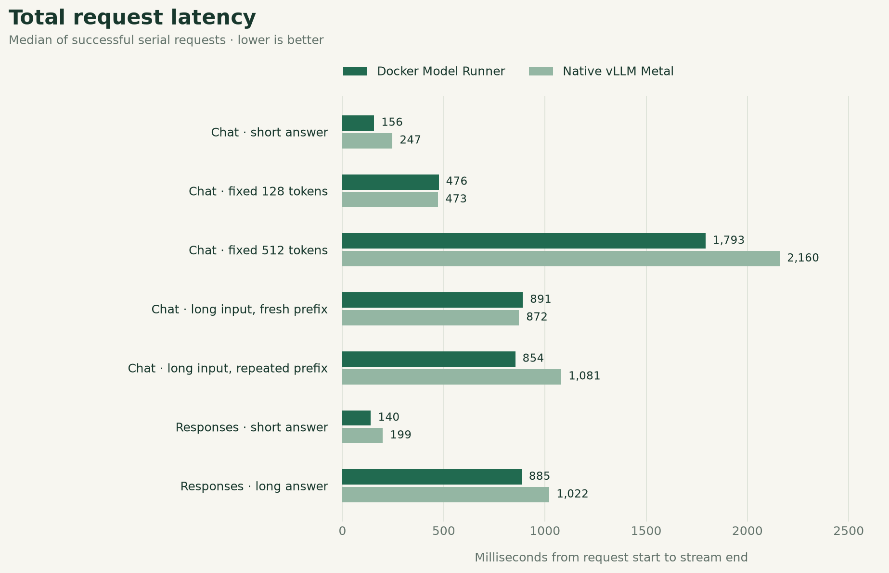
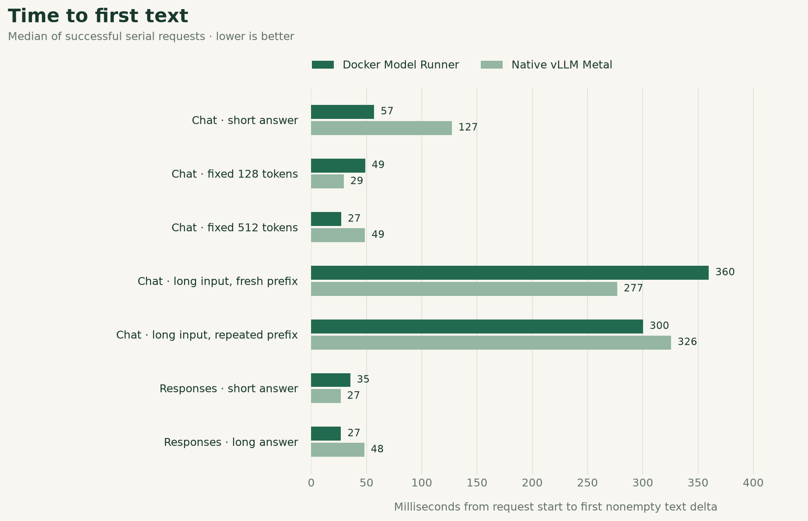
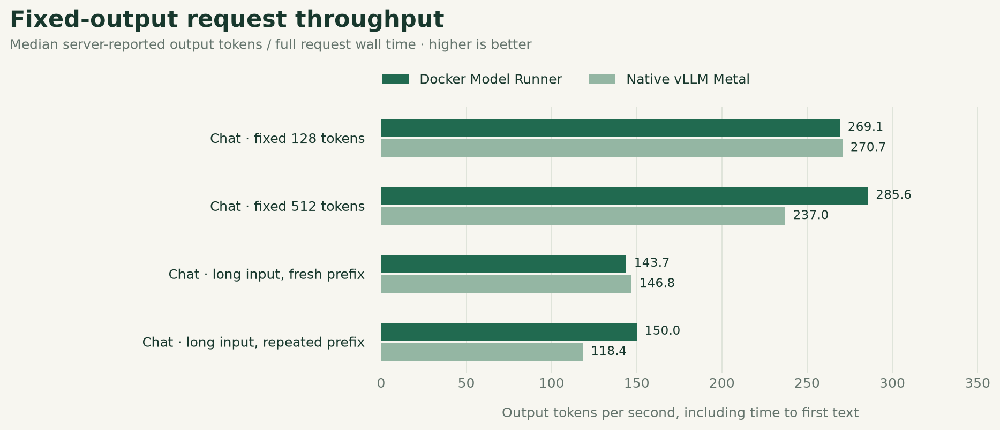
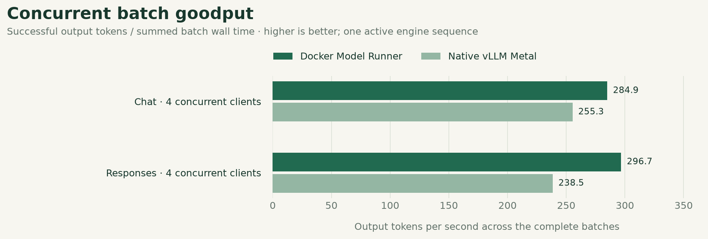

# Docker-managed vs native vLLM Metal benchmark

Same Qwen3-0.6B 4-bit weights, two deployed Metal services. Client-observed API performance on this Mac.

Run status: completed. Recorded 2026-10-22T05:23:23.446Z. Wall duration 0.3 minutes.

## Measured outcomes

- **Fixed 512-token Chat:** Native vLLM Metal took 1.21× as long. Median total: Docker 1,793 ms; native 2,160 ms.
- **Short Responses request:** Native vLLM Metal took 1.42× as long. Median total: Docker 140 ms; native 199 ms. Natural output lengths can differ.
- **Validation:** 30/30 measured requests passed; 0 failed. Warmups are excluded.

These are observations from this run, not a controlled estimate of Docker overhead or a claim of statistical significance.

## Serial workloads

| Workload | Service | Passed / total | Errors | Median total | p95 total | Median TTFT | Output tokens | Wall tok/s |
| --- | --- | --- | --- | --- | --- | --- | --- | --- |
| Chat · short answer | Docker Model Runner | 1/1 | 0 | 156 ms | 156 ms | 57 ms | 31 | 198.2 |
| Chat · short answer | Native vLLM Metal | 1/1 | 0 | 247 ms | 247 ms | 127 ms | 34 | 137.6 |
| Chat · fixed 128 tokens | Docker Model Runner | 1/1 | 0 | 476 ms | 476 ms | 49 ms | 128 | 269.1 |
| Chat · fixed 128 tokens | Native vLLM Metal | 1/1 | 0 | 473 ms | 473 ms | 29 ms | 128 | 270.7 |
| Chat · fixed 512 tokens | Docker Model Runner | 1/1 | 0 | 1,793 ms | 1,793 ms | 27 ms | 512 | 285.6 |
| Chat · fixed 512 tokens | Native vLLM Metal | 1/1 | 0 | 2,160 ms | 2,160 ms | 49 ms | 512 | 237.0 |
| Chat · long input, fresh prefix | Docker Model Runner | 1/1 | 0 | 891 ms | 891 ms | 360 ms | 128 | 143.7 |
| Chat · long input, fresh prefix | Native vLLM Metal | 1/1 | 0 | 872 ms | 872 ms | 277 ms | 128 | 146.8 |
| Chat · long input, repeated prefix | Docker Model Runner | 1/1 | 0 | 854 ms | 854 ms | 300 ms | 128 | 150.0 |
| Chat · long input, repeated prefix | Native vLLM Metal | 1/1 | 0 | 1,081 ms | 1,081 ms | 326 ms | 128 | 118.4 |
| Responses · short answer | Docker Model Runner | 1/1 | 0 | 140 ms | 140 ms | 35 ms | 33 | 235.2 |
| Responses · short answer | Native vLLM Metal | 1/1 | 0 | 199 ms | 199 ms | 27 ms | 33 | 165.6 |
| Responses · long answer | Docker Model Runner | 1/1 | 0 | 885 ms | 885 ms | 27 ms | 256 | 289.2 |
| Responses · long answer | Native vLLM Metal | 1/1 | 0 | 1,022 ms | 1,022 ms | 48 ms | 256 | 250.6 |

Output tokens show the observed minimum–maximum. Wall tok/s and timing columns are medians except the explicitly labeled p95.

## Concurrent workloads

| Workload | Service | Passed / total | Good / all batches | Median request | p95 request | Median TTFT | Median batch | Batch tok/s | Output tokens |
| --- | --- | --- | --- | --- | --- | --- | --- | --- | --- |
| Chat · 4 concurrent clients | Docker Model Runner | 4/4 | 1/1 | 1,153 ms | 1,797 ms | 734 ms | 1,797 ms | 284.9 | 128 |
| Chat · 4 concurrent clients | Native vLLM Metal | 4/4 | 1/1 | 1,226 ms | 2,005 ms | 759 ms | 2,005 ms | 255.3 | 128 |
| Responses · 4 concurrent clients | Docker Model Runner | 4/4 | 1/1 | 1,088 ms | 1,725 ms | 673 ms | 1,726 ms | 296.7 | 128 |
| Responses · 4 concurrent clients | Native vLLM Metal | 4/4 | 1/1 | 1,335 ms | 2,147 ms | 860 ms | 2,147 ms | 238.5 | 128 |

Batch tok/s is aggregate goodput over all measured batch wall time. Each batch submits four client requests; one active engine sequence can cause queueing.

## Total request latency



Median of successful serial requests · lower is better. [SVG](latency.svg).

## Time to first text



Median of successful serial requests · lower is better. [SVG](ttft.svg).

## Fixed-output request throughput



Median server-reported output tokens / full request wall time · higher is better. [SVG](throughput.svg).

## Concurrent batch goodput



Successful output tokens / summed batch wall time · higher is better; one active engine sequence. [SVG](batch-goodput.svg).

## Context and cache evidence

| Workload | Service | Input tokens | Reported cached tokens | Median TTFT |
| --- | --- | --- | --- | --- |
| Chat · long input, fresh prefix | Docker Model Runner | 1,993 | — | 360 ms |
| Chat · long input, fresh prefix | Native vLLM Metal | 1,993 | — | 277 ms |
| Chat · long input, repeated prefix | Docker Model Runner | 1,989 | — | 300 ms |
| Chat · long input, repeated prefix | Native vLLM Metal | 1,989 | — | 326 ms |

A missing cached-token counter is shown as —; it is not evidence of zero cache activity.

## Host and deployments

| Component | Recorded configuration |
| --- | --- |
| Host | Not recorded |
| Memory | Not recorded |
| OS | Not recorded |
| Power | Not recorded |
| Context / scheduling | 4,096 tokens; max_num_seqs=1 on both |
| Service A runtime | DMR: vLLM core 0.13.0 + Metal 0.1.0; local compatibility repair |
| Service B runtime | Native: vLLM core 0.32.0 + Metal 0.32.0 |
| Model | Qwen3-0.6B, MLX 4-bit; shared downloaded weight bundle |

## Method and limits

- 1 measured serial requests per service/workload, following 0 warmups. Concurrent workloads use 1 measured batches after 0 warmup batches. Inspect counts for partial or failed runs.
- Both engines remained resident. Services were exercised sequentially, alternating Docker/native order each round. Four-client tests overlap requests only within the selected service; both engines allow one active sequence, so these results include queueing.
- This compares the deployed applications. DMR uses vLLM core 0.13.0 / Metal 0.1.0 and a local Responses adapter; native uses core / Metal 0.32.0 and its own Responses implementation. Version, gateway, protocol and cache effects are confounded. These measurements do not isolate Docker overhead.
- Fixed-output Chat requests use ignore_eos and exact 128/512-token validation. Natural Chat and Responses requests may stop at different lengths. Compare token counts alongside latency; this is not an answer-quality evaluation.
- Fresh-prefix cases receive unique early request tags shared by the paired services. They reduce prefix reuse; they are not cold-start tests. The repeated-prefix case deliberately reuses one prompt. Reported cached-token counters may be absent or differ in semantics across runtimes.
- TTFT ends at the first nonempty output-text delta, excluding role and lifecycle events. Total latency ends when the HTTP stream ends. Wall throughput is server-reported output tokens divided by full request duration, not isolated decode speed.
- Concurrent batch goodput divides successful output tokens by batch wall time, with failed batch time retained in the aggregate. Per-request rates are never summed. Request quantiles within one batch are dependent samples.
- p95 uses nearest rank. With 10 serial samples it is the observed maximum; with five batch samples it is also the maximum. These small samples do not establish statistical significance or stable tail latency. The report describes this run only.
- Warmups and invalid requests remain in raw.json. Invalid requests are excluded from per-request latency/rate statistics; the tables expose their counts. No cold startup, energy, GPU utilization or peak-memory benchmark was performed. Other activity on the shared Mac can affect results.

## Evidence and reproduction

- [Raw requests, SSE, responses and warmups](raw.json)
- [Machine-readable aggregates](summary.json)
- [Spreadsheet-ready aggregates](summary.csv)

```sh
# From the project root; keep other inference idle
BENCH_REPEATS=1 BENCH_WARMUPS=0 \
BENCH_BATCH_REPEATS=1 BENCH_BATCH_WARMUPS=0 \
  node scripts/benchmark.mjs

# Render this recorded run again (no new inference)
MPLCONFIGDIR=.runtime/matplotlib .runtime/benchmark-tools/bin/python \
  scripts/benchmark-report.py docs/benchmarks/pilot
```
