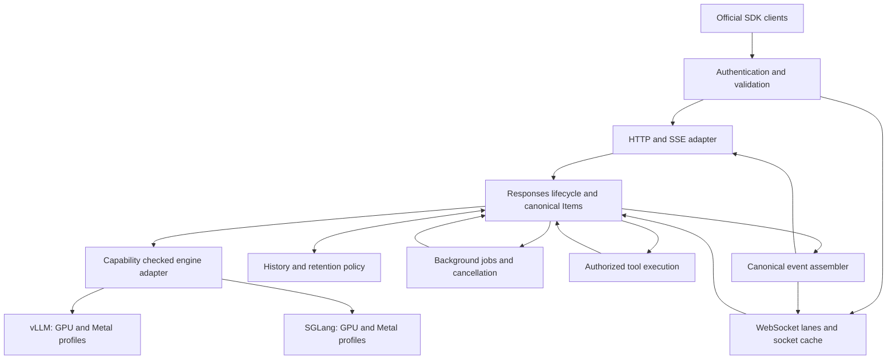

# Responses API implementation checklist and compatibility research

Source: https://chatgpt.com/space/page_d2ab672234848191b663c82d3b17b1b7
Retrieved: 2026-10-23

Build a service-owned Responses API layer supporting both vLLM and SGLang across declared GPU and Apple Metal runtime profiles. The first version must pass on macOS Metal with both engines. Own the public contract, typed Items, state, tools, and lifecycle in that layer. Reuse engine inference and parsing capabilities only after testing each engine, model, template, parser, and deployment mode together.

This research supports the Response-api project’s implementation planning. The target is observable compatibility with the official OpenAI API, not identical model intelligence or access to OpenAI-hosted infrastructure. Findings are dated **23 October 2026**. Repository findings come from pinned source and test inspection; no GPU inference deployment or live OpenAI differential suite was run.

# Decisions to make before implementation

| Decision | Recommended choice | Why it matters |
|---|---|---|
| Public abstraction | Responses-native typed Item model | A role/text transcript loses tool linkage, reasoning, content parts, and assistant phase. |
| Engine boundary | Both engines required; separate runtime/device capability profiles | Backend acceptance of a field does not establish its behavior. |
| State ownership | Service-owned history, response lifecycle, retention, and event sequencing | Engine-local dictionaries cannot provide restart recovery or cross-replica retrieval. |
| Initial compatibility | A declared core subset, followed by stateful and advanced profiles | A precise supported subset is testable; an unqualified claim of full parity is not justified by either repository. |
| Unsupported behavior | Reject explicitly before expensive work | Never silently remove storage, grammar enforcement, tools, or input content. |
| Evaluation | Separate protocol conformance, model quality, and operational performance | Different models should not be required to produce identical prose or token counts. |

OpenAI’s [migration guide](https://developers.openai.com/api/docs/guides/migrate-to-responses) changes three fundamentals: the endpoint, typed input/output Items, and management of conversation state. It also changes tool definitions, streaming, and structured-output placement. These are the minimum architectural boundaries.

# What the repositories currently provide

Source snapshots: vLLM [`022b43c66f6c2b39c8f0e7c4813544481aca43c0`](https://github.com/vllm-project/vllm/commit/022b43c66f6c2b39c8f0e7c4813544481aca43c0) and SGLang [`363e6c6b4d9240a46d2436f4b27d92b33d1b2f40`](https://github.com/sgl-project/sglang/commit/363e6c6b4d9240a46d2436f4b27d92b33d1b2f40). These are audited main-branch snapshots, not a recommendation to deploy an unpinned main branch.

| Surface | vLLM direct server | SGLang Python worker | SGLang Rust gateway regular gRPC |
|---|---|---|---|
| Create and SSE | Implemented, model/parser dependent | Implemented, separate regular/Harmony paths | Implemented through conversion and streaming layers |
| Retrieve and chaining | Implemented with local storage enabled | Implemented with local storage enabled | Storage interfaces and history loaders exist |
| Durable state | Process-local dictionaries/deques | Process-local dictionaries | External storage interfaces/configurations exist; consistency and retention still need verification |
| Background and cancel | Local jobs/cancel; requires store=true; replay/cancel edge cases need tests | Nonstream background jobs; requires store=true; background streaming is connection-bound and GET resume is absent | Regular create explicitly rejects background; common cancel handler is unsupported |
| Delete and input Items | Absent from reviewed Responses router | Absent from reviewed Python Responses routes | Routes are registered, but gRPC inherits default 501 implementations |
| Structured outputs | Constrained generation and SDK parse tests exist | Supported subset; Harmony restriction | Converted into Chat structured-output settings |
| Encrypted reasoning | Explicitly rejects encrypted reasoning input | Encodes reasoning using compression/base64, not encryption | No blanket parity established across gateway modes |
| Advanced parity | Compaction, token-count route, Conversations and Responses WebSocket not established in reviewed surface | Same scoped limitation | Different router modes require separate assessment |

The gateway’s Harmony and OpenAI-upstream proxy paths are distinct from regular gRPC. A proxy to an OpenAI upstream must not be counted as a capability of a local model.

**The strongest source-backed gaps are concrete:**

- vLLM defaults response storage off and silently changes requested `store=true` to false. Enabled stores are process-local, and the source warns that entries are never removed. See [store implementation](https://github.com/vllm-project/vllm/blob/022b43c66f6c2b39c8f0e7c4813544481aca43c0/vllm/entrypoints/openai/responses/serving.py#L162-L200) and [downgrade](https://github.com/vllm-project/vllm/blob/022b43c66f6c2b39c8f0e7c4813544481aca43c0/vllm/entrypoints/openai/responses/serving.py#L354-L361).

- Both direct implementations expose create, retrieve, and cancel, but not the whole Responses lifecycle surface. See [vLLM router](https://github.com/vllm-project/vllm/blob/022b43c66f6c2b39c8f0e7c4813544481aca43c0/vllm/entrypoints/openai/responses/api_router.py) and [SGLang HTTP routes](https://github.com/sgl-project/sglang/blob/363e6c6b4d9240a46d2436f4b27d92b33d1b2f40/python/sglang/srt/entrypoints/http_server.py#L2012-L2044). Both reject `background=true` with `store=false`: [vLLM validator](https://github.com/vllm-project/vllm/blob/022b43c66f6c2b39c8f0e7c4813544481aca43c0/vllm/entrypoints/openai/responses/protocol.py#L671-L681) and [SGLang admission](https://github.com/sgl-project/sglang/blob/363e6c6b4d9240a46d2436f4b27d92b33d1b2f40/python/sglang/srt/entrypoints/openai/serving_responses.py#L301-L308). SGLang detaches background work only on its [nonstreaming path](https://github.com/sgl-project/sglang/blob/363e6c6b4d9240a46d2436f4b27d92b33d1b2f40/python/sglang/srt/entrypoints/openai/serving_responses.py#L550-L621), and its GET route accepts no stream/cursor arguments. The service must supply temporary-background retention and resumable execution.

- SGLang’s Python `encode_reasoning_state` uses zlib and URL-safe base64 and explicitly disclaims cryptographic protection. Its custom-tool grammar is added to the prompt rather than enforced. See [reasoning adapter](https://github.com/sgl-project/sglang/blob/363e6c6b4d9240a46d2436f4b27d92b33d1b2f40/python/sglang/srt/entrypoints/openai/responses_adapters.py#L193-L217) and [grammar adapter](https://github.com/sgl-project/sglang/blob/363e6c6b4d9240a46d2436f4b27d92b33d1b2f40/python/sglang/srt/entrypoints/openai/responses_adapters.py#L35-L70).

- SGLang Python non-Harmony streaming clears `tools` in Response snapshots. Test consistency with the nonstream and stored objects. See [snapshot sanitization](https://github.com/sgl-project/sglang/blob/363e6c6b4d9240a46d2436f4b27d92b33d1b2f40/python/sglang/srt/entrypoints/openai/serving_responses.py#L2046-L2051).

- The SGLang regular gRPC gateway [rejects background](https://github.com/sgl-project/sglang/blob/363e6c6b4d9240a46d2436f4b27d92b33d1b2f40/sgl-model-gateway/src/routers/grpc/regular/responses/handlers.rs#L46-L75), while [default router methods](https://github.com/sgl-project/sglang/blob/363e6c6b4d9240a46d2436f4b27d92b33d1b2f40/sgl-model-gateway/src/routers/mod.rs#L139-L167) return 501 for unimplemented lifecycle operations. Route registration is insufficient evidence.

Additional source-level reproduction targets include vLLM chained-history loss of non-message output Items and filtering of explicit prior system-role input Items and replay termination after failures/cancellation; SGLang gateway status conversion, text-only conversion, and loading only the first 100 Conversation message Items. These are static findings to test, not runtime-certified defect reports. See [vLLM history conversion](https://github.com/vllm-project/vllm/blob/022b43c66f6c2b39c8f0e7c4813544481aca43c0/vllm/entrypoints/openai/responses/utils.py#L279-L305), [vLLM replay](https://github.com/vllm-project/vllm/blob/022b43c66f6c2b39c8f0e7c4813544481aca43c0/vllm/entrypoints/openai/responses/serving.py#L1117-L1147), [gateway status conversion](https://github.com/sgl-project/sglang/blob/363e6c6b4d9240a46d2436f4b27d92b33d1b2f40/sgl-model-gateway/src/routers/grpc/regular/responses/conversions.rs#L318-L338), and [gateway history loading](https://github.com/sgl-project/sglang/blob/363e6c6b4d9240a46d2436f4b27d92b33d1b2f40/sgl-model-gateway/src/routers/grpc/regular/responses/common.rs#L321-L349).

# Backend and hardware requirements

Both engines are mandatory. The service must carry adapters and configuration for GPU and Metal from the first version, while first-version real inference acceptance runs locally on macOS Metal with **both** engines. Metal is Apple’s GPU API; for planning, the first non-Apple GPU validation lane is Linux/NVIDIA CUDA. ROCm and other accelerators remain separately declared targets rather than an implied universal GPU certification.

| Required profile | Runtime path | Validation gate |
|---|---|---|
| vLLM on macOS Metal | Official `vllm-project/vllm-metal` plugin, default MLX compute path, with its matched vLLM core | Required real-hardware first-version run |
| SGLang on macOS Metal | Integrated SGLang MLX runtime with `SGLANG_USE_MLX=1` | Required real-hardware first-version run |
| vLLM on Linux GPU | Pinned vLLM CUDA distribution and engine adapter | Code/configuration required; real CUDA validation tracked separately |
| SGLang on Linux GPU | Pinned SGLang CUDA distribution and engine adapter | Code/configuration required; real CUDA validation tracked separately |

**The current Metal paths are concrete, but their feature sets need independent certification.** vLLM Metal provides the plugin while upstream vLLM supplies the API server and scheduler. Its [pinned installation guide](https://github.com/vllm-project/vllm-metal/blob/6d6f2c37f8242f1ff1a336534adf6c2d2fe2936d/docs/installation.md) requires Apple Silicon, macOS 15 or later, and Python 3.12 with matched prebuilt components; plain `pip install vllm-metal` is not its supported installation path. Use the audited [v0.32.0 release](https://github.com/vllm-project/vllm-metal/releases/tag/v0.32.0) as a candidate bundle: plugin/core 0.32.0 with its pinned MLX 0.32.2 dependency. Re-audit the exact bundled core: the earlier core-source snapshot is not automatically this release’s tested core. The [Metal grammar implementation](https://github.com/vllm-project/vllm-metal/blob/6d6f2c37f8242f1ff1a336534adf6c2d2fe2936d/vllm_metal/v1/structured_output.py) applies vocabulary masks through xgrammar and fails if that dependency is absent; verify installation and positive strict-schema behavior.

SGLang’s [pinned Metal guide](https://github.com/sgl-project/sglang/blob/363e6c6b4d9240a46d2436f4b27d92b33d1b2f40/docs/docs/hardware-platforms/apple_metal.mdx) documents the integrated MLX serving runtime on Apple Silicon, macOS 14 or later, stable Torch 2.13.x, and MLX 0.32.0 or later. Its startup validates framework versions and Metal availability. Use the common macOS 15+ baseline for the two-engine test host, with separate native arm64 Python 3.12 environments. Record the actual chip, RAM, OS build, packages, model revisions, and launch configuration.

**SGLang’s sampling flag is a first-version gate.** At the audited pin, [`mlx_enable_sampling`](https://github.com/sgl-project/sglang/blob/363e6c6b4d9240a46d2436f4b27d92b33d1b2f40/python/sglang/srt/arg_groups/fields/device.py#L47-L66) defaults to false. The flag enables MLX sampling and grammar vocabulary masks, among other features. A source-derived starting configuration is `SGLANG_USE_MLX=1` with `--disable-cuda-graph --mlx-enable-sampling`; this is not a substitute for strict-output tests. Penalties and prompt-input logprobs remain outside that path’s implemented sampler behavior. Do not silently accept unsupported extension parameters. Treat optional Torch MPS paths as distinct runtime profiles; “Metal” does not identify one interchangeable implementation.

## Implementation and Mac acceptance checklist

- [ ] **H01 P0** Implement both engine adapters and explicit runtime/device profiles. Keep the Responses core hardware-independent; use native runtime processes for Mac testing and separate environments. A mock, CPU fallback, remote CUDA server, or unrelated OpenAI-compatible runtime cannot satisfy a named Metal cell.

- [ ] **H02 P0** Pin each complete runtime bundle and verify startup identity, Metal availability, accelerator execution, model/tokenizer revision, and parser/decoder configuration. Fail the Metal test when model inference silently falls back to CPU; CPU tokenization or grammar-mask processing remains legitimate auxiliary work. Do not treat a successful health endpoint as proof of accelerator execution.

- [ ] **H03 P0** Run both engines sequentially on the same Mac as the default acceptance method, releasing model memory between runs. Concurrent residency is a separate memory/load test. Use a small common model such as the documented Qwen3-0.6B candidate for smoke tests, then a suitable declared model for required function/strict-output tests; matching family names alone do not prove equal quantization or templates.

- [ ] **H04 P0** Require the same declared first-version API profile on both Metal cells: JSON create, typed Items, SSE, function round trips, strict outputs, errors/usage, and basic WebSocket continuation. Explicit rejection is correct only for optional features; it does not satisfy a mandatory capability. Retained lifecycle and advanced WebSocket features keep their own gates.

- [ ] **H05 P0/P1** Maintain independent Mac and Linux GPU evidence. Platform-neutral CI validates the shared service and adapter contracts; native Apple Silicon runners validate both Metal integrations; real GPU runners validate each CUDA integration before it is advertised as verified. Record unsupported, untested, and passed separately.

| Test | Mac acceptance evidence required for each engine |
|---|---|
| M01 | Native arm64 runtime starts, local model executes on Metal, and no remote/CPU substitution occurs. |
| M02 | The same JSON/SSE fixtures pass through the service and the selected engine; terminal state, IDs, usage shape, and cancellation behavior remain correct. |
| M03 | Positive function-call/result and strict JSON-schema cases pass; invalid/unsupported cases reject accurately; the SGLang sampler flag is verified. |
| M04 | Basic WebSocket create, incremental tool-result continuation, transient predecessor cache, reconnect/full-replay, and interrupted-stream cases pass. |
| M05 | Kill/restart the engine and disconnect a slow client under bounded queues; no stale callbacks, divergent retry, or duplicate tool action appears. |
| M06 | Repeat runs under measured unified-memory pressure; record TTFT, tokens/s, cancellation delay, memory and swap. Cross-engine prose/token equality is not required. |

The test harness may exercise concurrent logical lanes without requiring simultaneous GPU kernel execution. Record actual admission, batching, and memory limits per runtime. Metal results do not establish CUDA performance, numerical identity, or CUDA-specific scheduling correctness. No Mac or GPU execution has been performed in this research environment.

# Compatibility scope and endpoints

Use three delivery profiles. These are proposed project milestones, not official OpenAI tiers.

| Profile | Required scope | Exit condition |
|---|---|---|
| Core | Explicitly stateless text, typed Items, roles, JSON/SSE, function calling, structured output, errors, usage, capability rejection | Official SDK workflows and deterministic protocol fixtures pass for declared models |
| Stateful | Retained responses, history, retrieve/delete/input Items, background/cancel/resume; retained WebSocket recovery; Conversations if advertised | Multi-replica recovery, retention, branching, pagination, and cancellation tests pass |
| Advanced | Selected multimodal inputs, custom grammar, remote MCP/hosted tools, opaque reasoning state, compaction, WebSocket multiplexing and steering | Each capability has its own positive, negative, interruption, and security tests |

| Public route | Contract to implement | Priority |
|---|---|---|
| `POST /v1/responses` | Create Response; JSON or SSE, typed input/output, parameter semantics | Core |
| `GET /v1/responses/{response_id}` | Retrieve; applicable include/stream/cursor behavior | Stateful |
| `DELETE /v1/responses/{response_id}` | Delete and return `object: response.deleted`, `id`, `deleted` | Stateful |
| `POST /v1/responses/{response_id}/cancel` | Background cancellation and repeated-cancel semantics | Stateful |
| `GET /v1/responses/{response_id}/input_items` | Ordered, cursor-paginated typed input Items ([reference](https://developers.openai.com/api/reference/resources/responses/subresources/input_items/methods/list)) | Stateful |
| `POST /v1/responses/input_tokens` | Count rendered input with the selected model’s tokenizer and context rules ([reference](https://developers.openai.com/api/reference/resources/responses/subresources/input_tokens)) | Advanced or earlier for admission planning |
| `POST /v1/responses/compact` | Return a compacted input window with opaque compaction state | Advanced |
| `/v1/conversations` and Item subresources | Separate durable Conversation resource lifecycle | Stateful if advertised |
| WebSocket `/v1/responses` | Responses client/server event protocol, including declared lane/steering features | P1 basic continuation; P2 multiplexing and steering |

The [official Responses reference](https://developers.openai.com/api/reference/responses/overview), [retrieve reference](https://developers.openai.com/api/reference/resources/responses/methods/retrieve), [delete reference](https://developers.openai.com/api/reference/resources/responses/methods/delete), and [official SDK resource implementation](https://github.com/openai/openai-python/blob/main/src/openai/resources/responses/responses.py) define these surfaces. Pin the exact reference/schema and SDK versions before implementation; discovery endpoints such as your own capabilities manifest are service extensions, not an official Responses endpoint.

An explicitly stateless Core release must require `store=false` and reject requests requiring the ordinary omitted/true storage behavior until the Stateful profile is ready. It must not silently change the official default to false. If unmodified clients using default requests are a launch requirement, move stored-response support into the first release.

For this project, the first macOS version targets Core plus basic transient WebSocket creation/continuation on both Metal runtimes. That pulls the applicable P1 socket checks into the first-version gate without claiming durable background/Conversation support. Simple text bring-up is an intermediate milestone: missing required function calling or strict structured output blocks Core acceptance on that runtime.

# Implementation checklist

P0 means required before the first production core release. P1 means required before advertising the related stateful capability. P2 means advanced or model-dependent support; it must be implemented faithfully or explicitly rejected. Every unchecked entry below is work to implement or validate, not a claim that existing code is absent.

## Contract and admission

- [ ] **C01 P0** Freeze a dated API/schema snapshot and machine-readable capability matrix covering routes, fields, defaults, enums, Item types, events, tools, and model restrictions. Link each advertised behavior to schema validation, positive and negative fixtures, implementation owner, and release gate. Mark unresolved behavior unverified and exclude it from the advertised profile.

- [ ] **C02 P0** Pin engine commit/release, model weights, tokenizer, chat template, reasoning parser, tool parser, constrained decoder, and official SDK versions and resolved protocol/storage/MCP dependency lockfiles as one tested configuration. Include runtime/plugin distribution, accelerator backend, OS/architecture, and launch flags; a passing CUDA configuration does not certify its Metal counterpart.

- [ ] **C03 P0** Implement Bearer authentication, tenant/project authorization, JSON content validation, request/body limits, model lookup, and stable request IDs.

- [ ] **C04 P0** Distinguish omitted, null, false, and empty values. Preserve documented defaults and field limits rather than inheriting a backend library’s defaults accidentally.

- [ ] **C05 P0** Validate accepted features before inference. Reject unsupported official fields/tool types and invalid combinations with a precise OpenAI-shaped error; keep backend extensions explicitly separate.

- [ ] **C06 P0** Keep compatibility evidence per deployment mode. A test passing for Harmony, regular decoding, a direct worker, or an upstream proxy does not certify the other paths.

Basis: [create reference](https://developers.openai.com/api/reference/resources/responses/methods/create), [API overview](https://developers.openai.com/api/reference/overview/), and the repository gaps above.

## Request mapping and typed Items

- [ ] **I01 P0** Accept string input and supported typed Item arrays; preserve ordering, all content parts, and system/developer/user/assistant roles.

- [ ] **I02 P0** Preserve assistant `phase` when replaying Items. Do not collapse commentary into the final answer or downgrade developer guidance to user text.

- [ ] **I03 P0** Build one canonical Response with its public ID, object type, creation time, status, output, error, incomplete details, usage, and applicable echoed configuration.

- [ ] **I04 P0** Keep Response IDs, Item IDs, tool `call_id`, engine request IDs, and retry-attempt IDs distinct. Function results must link to the correct `call_id`.

- [ ] **I05 P0** Preserve message, function-call, function-result, reasoning, refusal, annotations, and other supported Item types through replay. Do not store only final text.

- [ ] **I06 P0** Enforce `max_output_tokens` across the whole response, including supported reasoning and server-tool iterations. Default `truncation` to disabled and return 400 on excess context; truncate automatically only when requested and supported.

- [ ] **I07 P0** Map `text.format`, `reasoning`, `tool_choice`, `parallel_tool_calls`, sampling options, and `include` only where the selected model/parser implements them. Do not echo ignored values as proof of support.

- [ ] **I08 P0** Treat `output_text` as an SDK convenience computed from output Items; do not replace the canonical output array with a string. Preserve empty or tool-only outputs.

Basis: [migration](https://developers.openai.com/api/docs/guides/migrate-to-responses), [create schema](https://developers.openai.com/api/reference/resources/responses/methods/create), and [conversation state](https://developers.openai.com/api/docs/guides/conversation-state).

## Streaming and termination

- [ ] **E01 P0** Emit valid SSE framing with typed events and JSON payloads. Parse arbitrary byte fragmentation/coalescing when consuming backend streams.

- [ ] **E02 P0** Implement the lifecycle and supported Item/content events, including created/in-progress, added/delta/done, and accurate completed/incomplete/failed termination.

- [ ] **E03 P0** Maintain stable response/Item/call IDs, `output_index`, and `content_index`. Pin wire `sequence_number` behavior with schema and recorded fixtures; keep internal per-response event ordinals separate from connection counters. Isolate interleaved calls, content, and lanes.

- [ ] **E04 P0** Use one event assembler and canonical state for stream and nonstream paths. A replay of one run’s semantic events must reconstruct that run’s final object. Fence backend callbacks, event appends, terminal transitions, and tool dispatch with a single active attempt epoch; a late worker cannot mutate the response after ownership changes.

- [ ] **E05 P0** Distinguish errors before HTTP headers from errors after streaming starts. Preserve partial output and an accurate failure; never append a false completion to hide an error.

- [ ] **E06 P0** Exercise pinned Python, TypeScript, and Go SDKs: stream accumulation, final-response helpers, parsing helpers where available, and unknown-event handling. Test their documented behavior for incomplete and failed runs as well as success.

- [ ] **E07 P0** Bound slow-consumer queues and apply backpressure. Propagate disconnect/cancel to generation according to foreground/background policy.

- [ ] **E08 P1** Resume eligible background streams from committed response-event cursors, strictly after `starting_after`. Do not advance this cursor from `keepalive` events: the current background guide identifies their sequence values as connection counters. Handle expired, terminal, equal-to-terminal, and past-end cursors without hanging or regenerating output; do not invent a keepalive schema where the pinned SDK/reference lacks one.

- [ ] **E09 P0** Implement the current default-on delta obfuscation and its create/retrieve opt-out controls, or disclose this as an explicit compatibility deviation. Separately classify logprobs, reasoning-summary events, annotations, and advanced tool events by capability.

Basis: [streaming guide](https://developers.openai.com/api/docs/guides/streaming-responses), [event reference](https://developers.openai.com/api/reference/resources/responses/streaming-events), [retrieve](https://developers.openai.com/api/reference/resources/responses/methods/retrieve), and [SDK accumulator](https://github.com/openai/openai-python/blob/main/src/openai/lib/streaming/responses/_responses.py).

For a simple text success, the useful event relationship is `response.created` → response in progress → Item/content added → text deltas → text/content/Item done → `response.completed`. Tool, reasoning, failure, and incomplete paths have their own event branches. Do not treat this abbreviated sequence as the complete schema.

## State and retention

- [ ] **S01 P0/P1** Classify retention before dispatch in Core; add retained resources in P1. Resolve lifetimes separately for Response objects, Conversation Items, background jobs/events, socket context, tool records, and telemetry. `store=false` alone is not a no-persistence policy; reject combinations whose resource policies cannot be honored.

- [ ] **S02 P1** Implement storage defaults and expiry by the selected data-control profile. OpenAI documents ordinary 30-day Response retention, with the data-controls guide describing at least 30 days; do not promise universal exact-day deletion. Conversation Items have a separate lifecycle, and background defaults vary by data-control profile. State the service’s actual retention and deletion guarantees.

- [ ] **S03 P1** Materialize `previous_response_id` from canonical typed history. Preserve immutable parents and support branches without cross-branch contamination.

- [ ] **S04 P1** Apply current top-level instructions on each call; previous top-level instructions are not inherited through `previous_response_id`. Preserve ordinary transcript Items according to the contract.

- [ ] **S05 P1** Enforce mutual exclusion of `conversation` and `previous_response_id`. Implement Conversation prepend/append semantics and a deterministic concurrent-write policy.

- [ ] **S06 P1** Provide retrieve/delete/input-Item pagination with tenant checks and missing/expired/deleted-ID behavior. Input listing uses `after`, limit 1–100/default 20, descending order by default, and list metadata including first/last IDs and `has_more`. Deletion is not cancellation; verify descendant/reference behavior separately.

- [ ] **S07 P1** Make retained state and admitted background jobs recoverable across replicas and restart. Commit response state, replay events, and required Conversation updates under one recoverable consistency invariant before publishing success. Another replica must not return an older status after a terminal event. Job recovery does not imply resumable inference; apply B02 after partial output.

- [ ] **S08 P0/P1** Enforce the selected retention class in Core and extend it to each P1 resource. Apply deletion/expiry to events, caches, blobs, and backups under the declared policy. For the service’s transient foreground/socket profile, keep response context in memory and avoid durable response-content journals. Attached Conversations, temporary background state, tool storage, prompt caches, and telemetry require separate policies; do not equate `store=false` with OpenAI ZDR.

- [ ] **S09 P1** Record model/tokenizer/parser/adapter affinity needed for replay. Reject incompatible opaque state rather than interpreting it under a different model or issuer.

Resolve retention separately for each resource before generation:

| Resource | Retention decision |
|---|---|
| Response object | Apply `store` and the selected data-control profile; define retrieval, deletion, and expiry independently of engine memory. |
| Conversation Items | Attached input/output Items have their own durable lifecycle. A transient Response does not erase Conversation writes; Conversation deletion does not implicitly delete its Items. |
| Background job and replay events | Permit temporary execution/polling state under the background policy even with `store=false`; longer retention follows the selected profile. |
| Socket context | Keep connection-local history in memory; connection loss removes this cache. Stored-response fallback requires independently eligible retained state. |
| Tools, files, prompt/KV caches, and telemetry | Apply separate disclosed policies, including external executor retention. Reject a requested no-persistence profile when these resources cannot honor it. |

Basis: [conversation state](https://developers.openai.com/api/docs/guides/conversation-state), [migration](https://developers.openai.com/api/docs/guides/migrate-to-responses), and [background mode](https://developers.openai.com/api/docs/guides/background). The [Conversation delete reference](https://developers.openai.com/api/reference/resources/conversations/methods/delete) explicitly says its Items are not deleted; do not implement an implicit cascade as if it were official behavior. A separate full-erasure operation is a service policy. Database choice, transactional strategy, and conflict handling are engineering recommendations; OpenAI does not prescribe your implementation. The [data-controls guide](https://developers.openai.com/api/docs/guides/your-data) distinguishes Response application state, abuse-monitoring logs, cache state, and tool storage; these controls must not be collapsed into the `store` flag.

## Function calling and structured generation

- [ ] **T01 P0** Accept flat Responses function definitions and emit `function_call` Items with JSON-string arguments, names, IDs, and correlation IDs.

- [ ] **T02 P0** Support the advertised `none`, `auto`, `required`, forced-function and allowed-tools modes. Enforce `parallel_tool_calls=false` rather than relying on the model to comply.

- [ ] **T03 P0** Keep caller-executed functions separate from server-executed tools. A generation that returns function calls can be completed while the application still needs to execute them; do not invent an Assistants-style `requires_action` Response state.

- [ ] **T04 P0** Validate explicit strict schemas and use compatible constrained decoding. Reject unsupported constraints. Test nested objects, nullable required fields, arrays, enums, recursion limits, refusal, and truncation.

- [ ] **T05 P0** Implement the pinned API’s omitted-strict behavior. The current function guide describes attempted strict normalization with non-strict fallback when normalization is impossible; explicit `strict=false` opts out. On normalization fallback, verify the response tool reports `strict:false`.

- [ ] **T06 P0** Accumulate streamed function arguments safely and expose finalized calls with correct `call_id` correlation. Test missing, wrong, duplicate, and out-of-order results. Historical input Items provide context, not fresh execution authority; service execution requires a newly generated validated intent or a validated resumption of an existing pending intent, with current authorization. Support string and supported content-array outputs, or reject unavailable variants explicitly.

- [ ] **T07 P2** For custom tools, preserve raw string input/output and enforce advertised regex/Lark grammar. Prompting the model to follow a grammar is not grammar enforcement.

- [ ] **T08 P2** For server-run tools, add executor authorization, approval where required, credentials isolation, network policy, timeouts, concurrency limits, and output-size limits. `max_tool_calls` caps total built-in calls across tools in one response; application safety limits on client function calls are separate policies.

- [ ] **T09 P2** Choose a side-effect recovery profile before enabling server-run tools: executor-owned idempotency/status lookup, a retention-approved minimal durable operation record, or explicit unknown outcome with no automatic retry. If neither reconciliation nor safe ambiguity handling is available, disable automatic non-idempotent tools for that retention class. Caller-executed functions remain the application’s responsibility; no database alone guarantees exactly-once external execution.

- [ ] **T10 P2** Treat remote MCP as a distinct feature: server discovery/transport, allowed tools, authentication, approval request/response Items, call results/errors, continuation, and streaming all need conformance tests. Bind approvals to the tenant, exact call, tool/server, arguments, and current authorization; replayed approval-shaped Items are not sufficient proof.

Basis: [function calling](https://developers.openai.com/api/docs/guides/function-calling), [structured outputs](https://developers.openai.com/api/docs/guides/structured-outputs), and [remote MCP](https://developers.openai.com/api/docs/guides/tools-remote-mcp). Hosted web/file search, code execution, computer use, and image generation require real service implementations or upstream delegation. Exposing their type names does not reproduce their results or guarantees.

## Background execution and cancellation

- [ ] **B01 P1** Implement internal admission and documented queued/in-progress/terminal states independently of the HTTP connection. A background acceptance acknowledgement must follow a recoverable response/job admission commit under its retention class. Keep Response, Item, and tool-execution statuses separate; do not expose an invented accepted status.

- [ ] **B02 P0/P1** Apply this retry boundary to P0 streaming and P1 jobs. Add recoverable jobs with leases/fencing and bounded retries in P1. Before visible model output or an external side effect, a retry may be safe under the declared policy. After either occurs, never append a fresh generation to the same public stream unless exact continuation is proven; otherwise preserve the partial result and terminate accurately. Fence late callbacks and distinguish event replay from inference/tool re-execution.

- [ ] **B03 P1** Match the current background/storage combinations. OpenAI now documents `background=true` with `store=false` and temporary persistence of roughly ten minutes for execution/polling; do not hard-code the older store-true-only rule. For OpenAI MAM projects, background retention beyond that period requires explicit `store=true`; ZDR projects run background with `store=false`. Map any analogous service profile explicitly.

- [ ] **B04 P1** Implement repeated-cancel semantics and races against completion, tool dispatch, and worker loss. Fence stale workers after a terminal decision.

- [ ] **B05 P1** Keep background streaming resumable only under the documented admission conditions; the current guide requires creation with `stream=true` to start a later stream.

- [ ] **B06 P1** Bound polling/event retention and clean up terminal jobs. Cancellation must stop future work without claiming already-completed external side effects never occurred.

Basis: [background guide](https://developers.openai.com/api/docs/guides/background). Temporary background retention differs from long-term response storage; avoid describing every `store=false` workflow as having no disk persistence.

## Advanced model and transport features

- [ ] **A01 P2** Implement image/file inputs end to end: payload variants, file resolution, MIME/size limits, URL retrieval, preprocessing, model support, token accounting, and explicit rejection where unsupported.

- [ ] **A02 P2** Implement actual authenticated encryption if the service advertises confidential opaque reasoning state. Bind state to issuer, tenant, model/revision, format version, key version, and expiry; test tampering and key rotation.

- [ ] **A03 P2** Preserve finalized reasoning Items in manual replay. Service-issued opaque state is not interoperable with OpenAI ciphertext, and a raw reasoning trace is not automatically equivalent to an OpenAI reasoning summary.

- [ ] **A04 P2** Treat standalone compaction and automatic `context_management` compaction separately. Standalone compaction returns a canonical next input window, not a normal response ID; replay the whole returned window.

- [ ] **A05 P1** Add basic Responses WebSocket creation and incremental continuation with implicit streaming, no background flag, and socket-cache recovery. Use the dedicated WebSocket checklist below for transport, warmup, lane, and steering requirements.

- [ ] **A06 P2** If targeting current WebSocket parity, implement `stream_id` lane routing, FIFO within a lane, concurrency across lanes, context forks, error isolation, and connection/stream limits.

- [ ] **A07 P2** Treat `response.steer` as its own state transition protocol. A queued steering acknowledgement is not a committed successor response; verify pending tool-input and unsupported-combination rules.

- [ ] **A08 P2** Inventory newer fields and tools: assistant phase, prompt-cache options/breakpoints, context management, namespaces, tool search, async/programmatic tools, output schemas, moderation/access programs, and service tiers. Reject what is not implemented; do not inherit a broad schema as an unconditional promise.

Basis: [WebSocket mode](https://developers.openai.com/api/docs/guides/websocket-mode), [WebSocket events](https://developers.openai.com/api/reference/resources/responses/websocket-events), [compaction](https://developers.openai.com/api/docs/guides/compaction), and [create schema](https://developers.openai.com/api/reference/resources/responses/methods/create).

**Audio needs a separate compatibility decision.** The current streaming reference includes audio event names, while the reviewed create input union enumerates text/image/file and the migration matrix still marks audio as forthcoming. Those sources do not establish a complete working audio request contract. Keep telephony/full-duplex voice on a distinct Realtime/Audio adapter until an end-to-end Responses audio contract is verified. Responses WebSocket is not a substitute for Realtime turn-taking, VAD, or audio-session events.

## Production behavior and observability

- [ ] **P01 P0** Apply admission limits for requests, rendered input tokens, reserved output budget, active streams, queued jobs, tool calls, and memory. Prevent one tenant or long prefill from starving others.

- [ ] **P02 P0** Normalize HTTP errors and post-header stream errors. Provide useful request IDs and appropriate rate-limit/Retry-After headers; distinguish temporary overload from permanent invalid requests or quota policy.

- [ ] **P03 P0** Measure queue delay, prefill time, time to first token, inter-token gaps, total latency, tool latency, cancellation delay, resume delay, throughput, and goodput at p50/p95/p99.

- [ ] **P04 P0** Attribute input/output/reasoning/cache token usage to the actual backend tokenizer and work performed. Do not fabricate cache hits, cache writes, or reasoning counts.

- [ ] **P05 P0** Trace request → response → backend attempts → tool calls without logging credentials or unneeded prompt content. Request correlation IDs are not idempotency keys. Treat a lost create acknowledgement as an unknown outcome; do not promise OpenAI-compatible create deduplication without a verified contract. Any service-specific retry key must define tenant scope, payload mismatch, expiry, and in-flight behavior.

- [ ] **P06 P0** Protect media/tool fetching from SSRF, unsafe redirects, oversized/decompression payloads, and secret leakage. Enforce authorization on every response, conversation, Item, file, and opaque-state lookup.

- [ ] **P07 P1** Test rolling deployment, schema migration, key rotation, drain, storage outage, queue outage, worker OOM, expired leases, and deletion while work is active.

Operational choices are project requirements rather than official implementation mandates. The relevant public behavior is documented in [API overview](https://developers.openai.com/api/reference/overview/), [rate limits](https://developers.openai.com/api/docs/guides/rate-limits), and [error codes](https://developers.openai.com/api/docs/guides/error-codes).

# Proposed service architecture

The canonical store should preserve typed inputs and outputs, parent lineage, effective configuration, model/parser revisions, tool-call links, terminal outcome, and usage. A separate event record carries sequence numbers and replay cursors. Background jobs need leases and cancellation state; tool executions need their own outcomes and reconciliation records. Retention classes decide whether these records use durable storage, temporary storage, or memory only.

The following are proposed service consistency invariants, not claims about OpenAI’s internal implementation:

| Boundary | Required invariant |
|---|---|
| Background acceptance | A response ID and recoverable job admission exist before acknowledging accepted background work. |
| Retained completion | Final Response, applicable input Items, terminal replay event, and Conversation append form one recoverable commit. Publish completion only after that boundary; route or version-check reads until replicas agree. |
| Transient completion | Apply the same ownership/order rules in memory without introducing an undeclared durable journal. Process loss may make recovery impossible. |
| Attempt replacement | A new epoch fences old callbacks and dispatches. Previously visible output is never replaced by unrelated regeneration under the same response. |
| External side effect | Reconcile by the chosen T09 profile or preserve an unknown outcome. Transport retries and historical replay do not authorize another action. |

A practical adapter emits internal generation events such as text delta, reasoning delta, tool-call start/arguments/end, usage update, finish, and failure. The public event assembler assigns stable public IDs and produces the official wire schema. Keep an explicit engine request handle for cancellation.

There are two reuse paths. A native Responses backend can accelerate a tested subset, but each concern needs one owner. When the service owns history, storage, jobs, and tools, compile complete canonical input and disable conflicting backend chaining, persistence, background execution, and tool dispatch. Select a lower-level path if native flags cannot enforce that boundary; do not assume one control tuple works for every backend. Translate backend IDs/events into the service’s canonical representation and retain a cancellation handle. Any delegated state or tool ownership must be explicit and tested. A Chat Completions adapter can bootstrap text/function flows only when it preserves all advertised Item and phase semantics.

Both vLLM and SGLang are required. Use engine-specific adapters over separate runtime processes, with capabilities keyed by engine family, concrete runtime/plugin, API mode, device, model, tokenizer, parser, and decoder. Keep CUDA, Torch, and MLX imports and dependencies out of the public service process. Use isolated runtime environments so either engine can be upgraded or restarted independently. Benchmark each profile against direct calls to its own engine/model; this source audit does not establish a performance winner.

# WebSocket mode implementation

Treat WebSocket as a first-class transport over the same Responses core used by HTTP/SSE. Deliver basic socket creation and incremental continuation in P1; track multiplexing, forks, warmup, and steering as explicit capabilities with their own release gates. A partial release must describe its subset and reject unsupported events or fields. Full current WebSocket parity requires the whole selected official contract.

The [official WebSocket guide](https://developers.openai.com/api/docs/guides/websocket-mode) defines connection and continuation behavior; the [WebSocket event reference](https://developers.openai.com/api/reference/resources/responses/websocket-events) defines envelopes, steering, and errors. The values below are the documented baseline checked on 23 October 2026.

## Connection identity and context

| Identifier or resource | Responsibility | Must not be confused with |
|---|---|---|
| WebSocket connection | Transport ownership, authentication, queues, connection-local context cache | A durable Conversation or guaranteed replay log |
| `stream_id` | Ordered execution lane and event routing on that socket | Conversation history |
| `previous_response_id` | Parent context and response lineage, including forks | A lane or socket ID |
| Response and Item IDs | Identify generated results and their content | Tool `call_id`, which correlates a tool result |
| Engine KV/prefix cache | Optional inference acceleration | The semantic Item/history store |

Reusing a `stream_id` without `previous_response_id` starts a new response. Different stream IDs may share a completed parent and then branch independently.

| Current documented behavior | Implementation consequence |
|---|---|
| Send `response.create` to WebSocket `/v1/responses` | Use the Responses create payload with WebSocket-specific fields; do not emit SSE framing inside WebSocket messages |
| Streaming is implicit; `background` is unsupported | Do not require `stream=true` or reuse background-job semantics for sockets |
| Same-lane requests run FIFO without overlap | Schedule by lane without locking the whole socket during inference |
| Different lanes can run concurrently | Demultiplex interleaved events and isolate lane-scoped errors |
| Up to 16 active responses; more accepted requests queue | Separate active execution limits from queue/resource limits |
| Up to 32 named lanes, plus an implicit default lane | Validate distinct-lane count; default-lane events omit `stream_id` |
| Lane names are 1–256 ASCII letters/digits, underscores, hyphens, or periods | Empty string is invalid; omit the field to select the default lane |
| Connection lifetime is up to 60 minutes | Provide rotation and recovery; a new connection has a new context cache |
| `generate:false` prepares chainable state without model output | Warmup is a separate execution path, not an empty model completion |

## WebSocket implementation checklist

- [ ] **WS01 P1** Add authenticated WebSocket upgrade on `/v1/responses`, validate message types and request capabilities, and enforce payload/connection limits. Keep raw API credentials off browser clients; any browser-facing authentication facade is a separately designed service boundary.

- [ ] **WS02 P1** Reuse canonical Responses validation, Item conversion, lifecycle, and event construction. Send JSON event messages over the socket; keep HTTP/SSE framing in its own transport adapter.

- [ ] **WS03 P1** Implement one connection reader and serialized outbound writes, with independent generation tasks. Internally distinguish queued, engine-admitted, publicly-created, and terminal work. Freeze each request’s settings and predecessor reference; never substitute the lane’s latest response. Track internal request/response/lane/engine handles without inventing a public correlation field.

- [ ] **WS04 P1** Continue turns using `previous_response_id` plus only new Items. Preserve caller tool results, reasoning Items, assistant phase, and instruction rules from the common Responses contract.

- [ ] **WS05 P1** Maintain authorized, immutable connection-local history independently of engine KV caches. Keep the selected transient socket profile’s response context in memory; separately classify Conversation, tool, cache, and telemetry state. Do not add a durable response-content journal to recover transient socket history.

- [ ] **WS06 P1** Recover completed context after disconnect using eligible stored state or complete input replay with a null/omitted predecessor. Reconnecting does not restore the old cache or establish the outcome of an unacknowledged request. Do not infer generic WebSocket event resume or unfinished-job survival from HTTP background behavior.

- [ ] **WS07 P1** Handle `previous_response_not_found` explicitly. If a same-lane continuation errors, follow documented eviction; a failed cross-lane fork must preserve the shared source parent.

- [ ] **WS08 P1** Preserve tool results and execution records according to retention policy. A network retry or replay must not automatically repeat a completed external side effect.

- [ ] **WS09 P1** Bound inbound queues, outbound buffers, and per-tenant work. Define authorization rechecks, heartbeat/idle policies, and graceful drain. For unstarted queued work, use an explicit abandonment/cleanup policy on connection loss; report unknown outcomes where the wire protocol cannot establish whether execution started. Treat these as service policies and disclose deviations from verified wire behavior.

- [ ] **WS10 P1** Validate handshake failures separately from in-socket error envelopes. Route named-lane errors using `stream_id` and preserve unrelated active lanes.

- [ ] **WS11 P2** Implement multiple named lanes with FIFO ordering within each lane and concurrency across lanes. Preserve Item IDs, indexes, and reference-defined event sequencing when outputs interleave.

- [ ] **WS12 P2** Enforce the targeted connection/lane limits, including queuing above the active-response limit and the default lane’s separate counting rule. Disclose any stricter deployment limits as service policy.

- [ ] **WS13 P2** Implement cross-lane forks and their cache races. A queued `store=false` fork can lose its parent if the source advances or fails; do not promise that acceptance pins the parent indefinitely. Clients can wait for fork `response.in_progress` before advancing the source.

- [ ] **WS14 P2** Implement `generate:false` warmup and verify the returned ID can be used for continuation without fabricating output or generated-token usage.

- [ ] **WS15 P2** Handle compaction correctly: automatic compaction continues with the latest predecessor; standalone compact output becomes the complete input window of a new chain with no predecessor.

- [ ] **WS16 P2** Validate `response.steer` separately. Its request contains `type`, `previous_response_id`, and user input; it has no `stream_id`. Respect the explicit user-only semantic restriction even where reused generated schema unions look broader. Accept only the documented user-message fields `type`, `role`, and `content`; broader reused Item fields are not steering permission.

- [ ] **WS17 P2** Implement steering acceptance and commitment separately. `response.steer.accepted` transfers ownership of queued input; the successor’s `response.created` commits it. Preserve uncommitted input on `response.steer.failed`. Handle failures before a steer ID is allocated and preserve extensible pending reasons/error codes.

- [ ] **WS18 P2** Handle `response.steer.pending` after a completed response that needs client tool output or approval. Fill required-input stubs from saved results and send one continuation per parent on the same lane; do not resend accepted steering input or rerun tools.

- [ ] **WS19 P2** Gate steering by model/execution capabilities. The current reference excludes Conversations-bound responses and automatic compaction. An engine abort followed by regeneration is insufficient unless completed Items, tool effects, safe boundaries, and successor semantics are preserved.

- [ ] **WS20 P1** Pin and test official SDK WebSocket clients against the service. Do not assume HTTP helper compatibility proves WebSocket compatibility, or import Realtime events such as `response.cancel` without a Responses contract. The reviewed client-event reference lists create and steer; background cancellation is a different route and mode. In the [official Go helper](https://github.com/openai/openai-go/blob/main/responses/responses_websocket.go), lane `Close()` detaches local consumption, keeps the lane name reserved, and does not cancel remote work or close the socket. Test these distinctions and treat EOF without a terminal event as interruption.

## Steering lifecycle and uncertainty

An accepted steer can lead to a safe-boundary incomplete response with reason `steered`, followed by an automatic successor, or to normal completion followed by a successor. Automatic successors inherit the previous response settings. When required client input blocks continuation, accepted input remains queued; the explicit continuation retains its own settings and receives queued steering input in submission order.

If the socket drops before an acknowledgement or successor is observed, the outcome is unknown and can remain unknowable after connection-local state is lost. Retain the submitted input client-side until commitment or return is confirmed; do not blindly resend it. Reconcile using evidence actually available, or apply an explicit abort/manual-reconciliation policy. A service-specific operation ledger is an extension and must obey retention rules; the reviewed official protocol does not establish universal lookup or exactly-once steering. A failure event can return uncommitted input only if the client receives it. See the [steering event reference](https://developers.openai.com/api/reference/resources/responses/websocket-events#response.steer).

## Integration with vLLM and SGLang

The recommended connection manager lives in the Response-api service. It can dispatch generation through a backend’s HTTP streaming interface or internal engine API; native engine WebSocket support is not a prerequisite. Reuse the same engine adapter as HTTP/SSE and keep socket/lane scheduling above it. When consuming SSE internally, parse the event stream correctly before translating canonical events into WebSocket JSON.

Keep the latest canonical context in the connection owner. Use connection affinity or an equivalent explicit ownership mechanism within the service; backend worker affinity is a separate performance choice for prefix-cache reuse. On owner loss, use the documented recovery paths rather than implying that transient state survived. If an engine loses its KV cache, reconstruct its input from canonical Items; cache loss alone must not erase known conversation history.

Steering needs additional adapter capabilities beyond ordinary token streaming: a safe stopping boundary, preservation of completed Items, accurate handling of dispatched tools, and continuation from the accepted context. Mark steering unsupported until those invariants pass for the actual model/parser/engine combination.

## WebSocket acceptance and performance gates

| Test | Scenario | Pass condition |
|---|---|---|
| W01 | Two requests in one lane and concurrent requests in different lanes | FIFO within lane; overlap across lanes; no accidental history from lane reuse |
| W02 | Empty/Unicode/overlength names, 32 named lanes plus default, 16 active responses plus queued work | Correct ASCII validation/counting, bounded queues, accurately scoped errors |
| W03 | Interleaved text, reasoning, and parallel function arguments | No response/Item/call-ID mixing; terminal objects reconstruct correctly |
| W04 | Cached fork queues while source advances or fails | Missing-parent behavior is explicit; failed fork does not corrupt source context |
| W05 | Socket loss and 60-minute rotation with stored/transient histories | Stored recovery when available; otherwise full replay; no undeclared retained transient content |
| W06 | Warmup followed by continuation; backend OOM or fragmented upstream stream | Chainable warmup with no output; accurate failure; other lanes remain usable |
| W07 | Disconnect around acceptance, interruption, successor/failure; owner loss; failure before ID allocation | Preserve absent/known steer IDs; unresolved cases remain unknown; no invented successor or automatic resend |
| W08 | Multiple steers while client tool results/approvals are pending | One continuation per parent; saved results reused; no duplicate action or steering input |
| W09 | Slow reader, queued default/named creates, credential change, drain/owner loss, SDK lane close | Bounded queues; declared abandonment policy; correct lineage; lane detach is not remote cancel; unknown creates are not blindly replayed |
| W10 | Same workload over HTTP keepalive plus SSE and over WebSocket | Measure per-turn continuation latency, TTFT, end-to-end latency, throughput, memory, and error rate using the same model and cache configuration |

OpenAI reports up to roughly 40% faster end-to-end execution for some workflows with 20 or more tool calls. Treat this as OpenAI’s workload-specific observation, not an expected improvement for this service. Benchmark cold/warm context, warmup on/off, single/multiple lanes, and realistic tool latency. A persistent socket does not itself eliminate model prefill, GPU queuing, or context-token accounting. [Official performance context](https://developers.openai.com/api/docs/guides/websocket-mode)

# Conformance tests and release gates

Use three test layers: source-derived golden protocol fixtures with a deterministic engine/tool harness; real-engine integration for model/template/parser behavior; and captured official wire fixtures for differential checks and disputed semantics. A mock must not define its own conformance oracle, and SDK deserialization alone is insufficient. Normalize random IDs/timestamps and compare invariants rather than model prose, hidden reasoning, or token counts across tokenizers. Begin with a named client profile covering pinned Python/TypeScript create, streaming/final helpers, function round trips and structured parsing, plus Go create/stream smoke tests; add the actual SDK WebSocket operations before advertising socket support.

| Test | Scenario | Required observation |
|---|---|---|
| V01 | String input, typed input, all roles, assistant phase, empty/tool-only output | No silent conversion or content loss; SDK reads the declared shape |
| V02 | Omitted/null/false values and every unsupported capability | Correct default or explicit pre-execution rejection |
| V03 | Unicode and JSON fragments split/coalesced across transport chunks | Correct reconstruction without cross-call or cross-Item mixing |
| V04 | Raw SSE, SDK accumulator, final-response helper, structured parser | Supported success paths work; incomplete/failed cases do not become false success |
| V05 | Function call with different Item ID and call_id; parallel results returned out of order | Exact correlation and stable identities across stream, retrieve, and continuation |
| V06 | Strict schema, unsupported schema, invalid grammar, refusal, cutoff mid-JSON | Genuine enforcement, bounded compilation, accurate refusal/incomplete behavior |
| V07 | Manual replay versus previous_response_id; top-level instructions A → B/A → omitted, plus separate system/developer input Items | Old top-level instructions are replaced; explicit transcript Items and tool/reasoning history survive. Confirm the distinction with official fixtures |
| V08 | Two branches and a Conversation exceeding 100 Items, including tools/reasoning | No branch contamination or silent pagination/history truncation |
| V09 | Store true/false with manual history, Conversation, background, socket; mixed-retention parent/child; expiry/deletion/restart | Each resource matches its declared retention; no unintended cascade or resurrection; no success after failed required persistence |
| V10 | Resume before/at/after terminal; cancelled/failed replay; keepalive immediately before disconnect | Strictly-after response-event replay; keepalive does not advance cursor; no hangs or regeneration |
| V11 | Repeat cancel and race it with completion, tool dispatch and expired leases | One valid terminal outcome; stale workers cannot resume work |
| V12 | Crash after external tool success before result commit, including transient store=false | Reconcile the same operation when supported; otherwise retain an unknown outcome and suppress automatic repeat without covert persistence |
| V13 | Other tenant’s IDs, media URLs, files, MCP credentials and opaque state | Isolation holds at every lookup/fetch/cache boundary |
| V14 | Output caps 1/2/3 and across server-tool rounds; context overflow; OOM after headers | Accurate total budgets, errors, incomplete metadata, and usage |
| V15 | Slow readers, burst load, long/short prompts, tool delays, rolling restart | Bounded memory/queues and workload-specific latency/error SLOs |
| V16 | WebSocket concurrent lanes, cached fork, reconnect, pending-tool steering | Lane isolation, correct cache-loss recovery, acknowledgement/commit distinction |
| V17 | Kill/partition an engine after public deltas; replacement diverges; old callbacks arrive late | One fenced attempt owns output; no divergent append, duplicate tool intent, or false success; committed prefix remains replayable |
| V18 | Crash between job admission, response/event write, Conversation append, and terminal publication | No acknowledged job disappears; no duplicate Conversation append; cross-replica retrieve/continue sees a consistent completed result |
| V19 | Replay historical side-effecting calls; forged/modified approvals; valid approval of a pending MCP call | No execution from replay alone or cross-call/tenant approval reuse; a valid pending-call resumption still executes once under the selected recovery profile |
| V20 | Mutate golden defaults, status, call_id, phase, argument-done fields, strict fallback, or obfuscation | Release gate fails even when SDK deserialization succeeds; ambiguous advertised behavior requires an official fixture |

Suggested release order:

1. **Freeze the contract.** Publish a dated support manifest and pin all dependencies. Resolve documentation differences through schema/SDK review and targeted official fixtures. Every advertised matrix cell needs an owner and source-backed positive/negative fixture. Launch-relevant ambiguity requires a captured official fixture or exclusion from the supported profile.

2. **Deliver the first macOS version on both engines.** First prove native Metal execution, then require the same Core text/Items/function/strict-output/SSE/error/usage profile and basic WebSocket continuation tests on vLLM Metal and SGLang MLX. Missing required behavior blocks acceptance; successful rejection alone does not pass a required-feature test. Keep Linux GPU adapters in the codebase and track their hardware validation separately.

3. **Deliver state and recovery.** Retrieve/delete/input Items, retention, history, background, cancellation, resume, and retained WebSocket recovery pass crash, race, and multi-replica tests. Add Conversations before claiming that capability.

4. **Promote advanced capabilities separately.** Add multimodal, custom grammar, MCP/hosted tools, encrypted state, compaction, and WebSocket multiplexing/steering only after their specific tests pass.

5. **Run a production canary.** Establish numerical targets before testing; run soak, burst, failure injection, and rolling-upgrade exercises. Expand traffic only while correctness and SLO gates hold.

The first implementation milestone should therefore be the compatibility manifest, canonical Item/Response types, deterministic event assembler, and conformance harness. These create a stable boundary for supporting both engines and their separately validated GPU/Metal runtimes without allowing its current compatibility gaps to become the public service contract.

# Source interpretation and limits

OpenAI’s current documentation contains details older checklists can get wrong: background `store=false` is allowed with temporary persistence; WebSocket supports named concurrent lanes and steering; encrypted reasoning is described as returned by default; and omitted function strictness includes normalization/fallback behavior. Preserve the dated baseline rather than relying on older examples.

Reconcile normative behavior, detailed schemas, SDK behavior, and captured wire fixtures; none is a universal override for the others. A broad reused schema union does not override an explicit semantic restriction such as steering’s user-only input. Resolve launch-relevant disagreements with an official fixture or exclude the behavior. Known examples include arguments-done fields, keepalive counters versus typed event unions, and WebSocket numbering scope. Audio event vocabulary alone does not establish a complete audio creation flow.

This report does not certify complete OpenAI parity, production readiness, or live exploitability of source-level concerns. It provides an implementation backlog and evidence-based tests. No remote repository changes, paid model calls, or load tests were performed.

